# A mass-conservative staggered immersed boundary model for solving the shallow water equations on complex geometries

**Alberto Canestrelli**1,* ,†, **Aukje Spruyt**2, **Bert Jagers**2, **Rudy Slingerland**1, and **Mart Borsboom**2

1 Department of Geosciences, Pennsylvania State University, University Park, PA, USA  
2 Deltares, Delft, The Netherlands

*Correspondence to: Alberto Canestrelli, Department of Geosciences, Pennsylvania State University, University Park, PA, USA; auc26@psu.edu.*

**DOI:** [10.1002/fld.4180](https://doi.org/10.1002/fld.4180)  
**Published:** 23 October 2015 (International Journal for Numerical Methods in Fluids, 2016, 81:151–177)

## Summary

In this work, an approach is proposed for solving the 3D shallow water equations with embedded boundaries that are not aligned with the underlying horizontal Cartesian grid. A hybrid cut-cell/ghost-cell method is used together with a direction-splitting implicit solver: Ghost cells are used for the momentum equations in order to prescribe the correct boundary condition at the immersed boundary, while cut cells are used in the continuity equation in order to conserve mass. The resulting scheme is robust, does not suffer any time step limitation for small cut cells, and conserves fluid mass up to machine precision. Moreover, the solver displays a second-order spatial accuracy, both globally and locally. Comparisons with analytical solutions and reference numerical solutions on curvilinear grids confirm the quality of the method.

**Received:** 23 September 2014; **Revised:** 15 September 2015; **Accepted:** 21 September 2015  
**Keywords:** shallow water; immersed boundary; implicit; hydrodynamics; free surface; finite difference

> Converted from [Canestrelli16.pdf](Canestrelli16.pdf). The 17 embedded figures were extracted to [Canestrelli16_images/](Canestrelli16_images/); each figure caption below links to its corresponding image. Displayed mathematics is typeset in LaTeX, with the printed equation numbering retained.

## 1. Introduction

In natural systems, free-surface flows often occur in domains with complicated boundaries. One way to deal with such boundaries in numerical flow simulations is to use boundary-fitted structured or unstructured grids (e.g., [1, 2]). However, when a boundary changes position in time, many complications arise with remeshing of unstructured or curvilinear grids. For this reason, in the past decades, the so-called immersed boundary method has become popular (for recent reviews of the method, see [3, 4]). A boundary is said to be immersed in the grid if it does not coincide with the grid lines of the grid, that is, the boundary may cut through the grid at many places. This method is usually based on Cartesian grids, because they have several advantages: (i) their computer implementation has reduced memory requirements (and faster memory access); (ii) simple, efficient, and accurate numeral schemes can be used; (iii) they are easily parallelized/partitioned; and (iv) when a boundary changes position in time, boundary immersed methods based on Cartesian grids are usually much simpler to implement than moving-mesh methods based on body-fitted curvilinear or unstructured grids [4]. Among the most popular and accurate versions of the immersed boundary method are the cut-cell and the ghost-cell approaches. The former reduces the active area and edges of the cells cut by a boundary. The discretization is also changed in proximity of the boundary, and this usually ensures mass conservation up to machine precision. However, very small cut cells can be generated that

constrain the time step to a small value in order to ensure numerical stability, unless complex merging techniques are used [5]. The ghost-cell method overcomes this difficulty by using ghost cells located beyond the immersed boundary. In these cells, specific values for the unknowns are prescribed such that the sought boundary condition at the immersed boundary is satisfied. Despite being relatively recent, this method has already successfully solved various fluid mechanics problems with static or moving boundaries, such as the motion of insects in air [6], the vocal fold paralysis [7], bruits in a stenosed artery (Seo and Mittal [8]), and ventricular flow [9]. This approach does not introduce any extra stability constraint in the representation of solid bodies [4, 32]. In this work, we are specifically interested in solving the 3D shallow water equations in arbitrary planar domains (i.e., on 2D domains that do not depend on the vertical coordinate). Most of recent contributions propose immersed boundary methods for solving the 2D shallow water equations in the context of cell-centered explicit finite volume schemes, by using either a cut-cell technique [10–15] or a ghost-cell approach [16–18]. All these studies employ an explicit Riemann solver, and therefore, the time step is limited by the Courant–Friedrichs–Lewy (CFL) condition for stability. In our work, inspired by the approach proposed by Seo and Mittal [19] for solving the Navier–Stokes equations, we propose a mixed approach: Ghost cells are used for the momentum equations, while the continuity equation is solved by using a cut-cell approach. In fact, it has been shown by Seo and Mittal [19] that a standard ghost-cell method does not conserve mass and can give pressure oscillations in the proximity of the boundary. For the shallow water equations, it is of utmost importance to reduce unphysical oscillations of the water surface, especially when used for early warning of floods in river and tidal environments. Unlike Seo and Mittal [8], who used an explicit (i.e., CFL-bounded) scheme on a collocated (i.e., cell-centered) grid, we use an implicit time integration scheme on a staggered grid, in which the locations of the velocity points are shifted with respect to the location of the water surface elevation. Despite the complexity arising from the discretization of equations near boundaries, a staggered grid has several advantages [20]: (i) efficiency of the resulting scheme in particular when combined with alternating direction implicit (ADI) time integration [21], in which unconditional linear stability (see discussion in Section 4) allows one to efficiently solve domains with both deep and shallow areas (i.e., tidal channels, tidal flats, and river floodplains) because the time step is not restricted by the deepest cells; (ii) it avoids nonphysical water level oscillations (or checkerboard mode) without the use of numerical dissipation [22]; and (iii) it allows a straightforward extension to 3D hydrostatic and non-hydrostatic free-surface flows [23, 24]. To the authors’ knowledge, no immersed boundary method is present in the literature that solves the 3D shallow water equations on a staggered grid with an implicit ADI-type time discretization. As a framework, we use the open source hydrodynamic model Delft3D [25], which some of the authors are presently contributing to develop. Our motivation for devising an immersed boundary method in Delft3D is given by the following considerations: (i) all the features already available in Delft3D can now be extended to the case in which very complex bank shapes are encountered, for which boundary-fitted grids are not possible; (ii) Delft3D employs an implicit ADI-type solver that does not have to obey to the CFL < 1 restriction, and therefore, relatively large time steps can be used (Section 4); and (iii) finally, we note that by accurately solving hydrodynamics in any geometry, the solver can be potentially coupled with a bank erosion module that allows boundaries to reacts to the flow and move across the Cartesian grid. In this regard, we want to stress that the immersed boundary here developed is a ‘planar’ immersed boundary; that is, the boundary is 2D, and its shape does not depend on the vertical coordinate. For 2D immersed boundaries, prescribing ghost cells quantities and performing the geometric reconstruction for cut cells is simpler and faster than for a 3D immersed boundary. Moreover, because erosion processes at banks often consist of bank undercutting and successive collapse of the upper hanging layer, it is very complicated and computationally expensive to employ a 3D immersed boundary approach for modeling bank erosion. While this paper only deals with nonmoving banks, the final goal of our research is to develop a model that is able to reproduce long-term (10–1000 years) morphodynamics in complex geometries in an efficient way. Toward this end, we solve the 2D and 3D hydrostatic shallow water equations that do not contain a momentum equation for the vertical velocity and are computationally less

expensive than the Navier–Stokes equations. Moreover, we here devise and carefully test a 2D immersed boundary method that does not introduce any time step limitation, and we will focus on the moving-bank approach in a following paper. This paper is organized as follows. The numerical model for solving the 3D shallow water equations is presented in Section 2. Section 3 describes the mixed cut-cell/ghost-cell immersed boundary method to solve the equations for any complex geometry. Section 4 tests the model against analytical and numerical solutions on curvilinear grids. Conclusions are drawn in Section 5.

## 2. Mathematical And Numerical Model

### 2.1. Governing equations

In a rectilinear Cartesian coordinate system (x, y, z), with the z-axis vertically upward, the system of governing 3D shallow water equations for fluid flow reads (hydrostatic equilibrium in vertical direction assumed) as follows:

\[
\left(\frac{\partial u}{\partial t}+u\frac{\partial u}{\partial x}+v\frac{\partial u}{\partial y}+w\frac{\partial u}{\partial z}\right)
=-\frac{1}{\rho}\frac{\partial p}{\partial x}+F_x+\frac{\partial}{\partial z}\left(\nu_V\frac{\partial u}{\partial z}\right)
\tag{1}
\]

\[
\left(\frac{\partial v}{\partial t}+u\frac{\partial v}{\partial x}+v\frac{\partial v}{\partial y}+w\frac{\partial v}{\partial z}\right)
=-\frac{1}{\rho}\frac{\partial p}{\partial y}+F_y+\frac{\partial}{\partial z}\left(\nu_V\frac{\partial v}{\partial z}\right)
\tag{2}
\]

\[
\rho g=-\frac{\partial p}{\partial z}
\tag{3}
\]

\[
\left(\frac{\partial u}{\partial x}+\frac{\partial v}{\partial y}+\frac{\partial w}{\partial z}\right)=0
\tag{4}
\]

In the previous equations, u, v, and w are the velocities in the x, y, and z directions, respectively. p is the fluid pressure, ρ is the water density, g is the gravitational acceleration, Fx and Fy are the horizontal diffusion terms, and \(\nu_H\) and \(\nu_V\) are the horizontal and vertical eddy viscosities, respectively. The Reynolds stresses are modeled by using the eddy viscosity concept; therefore, Fx and Fy read as follows:

\[
\begin{aligned}
F_x&=\frac{\partial}{\partial x}\left(2\nu_H\frac{\partial u}{\partial x}\right)+\frac{\partial}{\partial y}\left[\nu_H\left(\frac{\partial v}{\partial x}+\frac{\partial u}{\partial y}\right)\right],\\
F_y&=\frac{\partial}{\partial x}\left[\nu_H\left(\frac{\partial v}{\partial x}+\frac{\partial u}{\partial y}\right)\right]+\frac{\partial}{\partial y}\left(2\nu_H\frac{\partial v}{\partial y}\right).
\end{aligned}
\]

The vertical viscosity coefficient is computed by the following:

\[
\nu_V=\nu_{\mathrm{mol}}+\nu_{3D}
\tag{5}
\]

\[
\nu_H=\nu_{\mathrm{mol}}+\nu_{3D}+\nu_{2D}
\tag{6}
\]

where \(\nu_{2D}\) is simply approximated as a constant in this work. For 3D shallow water flow, because horizontal and vertical length scales will be of different orders, the stress tensor is anisotropic with the horizontal eddy viscosity coefficient, \(\nu_H\), usually much larger than the vertical eddy viscosity \(\nu_V\) [27].

The molecular viscosity is orders of magnitude smaller than the eddy viscosity and can be neglected. The coefficient \(\nu_{3D}\) is given by [28] the following:

\[
\nu_{3D}=c'_{\mu}L\sqrt{K}
\tag{7}
\]

where \(c'_{\mu D}=c_\mu^{1/4}\) with \(c_\mu=0.09\), L is the mixing length, and K is the turbulent kinetic energy. Here, we assume a simple algebraic closure model, based on a logarithmic velocity profile. This leads to the following linear relation for the turbulent kinetic energy:

\[
K=\frac{1}{\sqrt{c_{\mu}}}\left[(u'_*)^2\left(1-\frac{z+d}{h}\right)\right]
\tag{8}
\]

where d is the depth below the reference plane, h is the water depth, and \(u'_*\) is a modified form of the bed friction velocity \(u_*\) [25]. The mixing length is taken as [29] follows:

\[
L=\kappa(z+d)\sqrt{1-\frac{z+d}{h}}
\tag{9}
\]

### 2.2. Numerical approach

A finite difference method that can be classified under the ADI type [21, 30] is used in the horizontal direction, and an implicit time integration is used for the vertical direction. This ADI-type method uses two stages to proceed one time step: In the first stage, the momentum equation in y direction is solved explicitly with respect to the water levels, and the continuity and momentum equation in x direction are solved implicitly with respect to the water levels. In the second stage, the order is reversed. The method is described in full detail in Deltares [25] and here summarized for reference in subsequent sections.

#### Stage 1

The momentum equation in the y direction is made explicit with respect to the water levels, and for each vertical layer k, it reads (the subscript k is omitted for clarity) as follows:

\[
\begin{aligned}
\frac{v^{n+1/2}-v^n}{\Delta t/2}+u^n\frac{\partial v^{n+1/2}}{\partial x}+v^n\frac{\partial v^{n+1/2}}{\partial y}+w^n\frac{\partial v^{n+1/2}}{\partial\sigma}
&=-g\frac{\partial\zeta^n}{\partial y}+\frac{1}{(d+\zeta^n)^2}\frac{\partial}{\partial\sigma}\left(\nu_{3D}\frac{\partial v^{n+1/2}}{\partial\sigma}\right)+2F_y^{n+1/2}
\end{aligned}
\tag{10}
\]

\[
\sigma=\frac{z-\zeta}{d+\zeta}=\frac{z-\zeta}{h}
\tag{11}
\]

with ζ the free-surface elevation above the reference plane (at z = 0). Note that in the momentum equation, the gradient of water surface appears, while the gradient of pressure has been removed. In fact, by integrating (3) in the vertical, we obtain \(\rho=\rho g(\zeta-z)\), with ζ as the water surface elevation, implying \(\partial p/\partial x=g\rho\,\partial\zeta/\partial x\) and \(\partial p/\partial y=g\rho\,\partial\zeta/\partial y\). The coupled continuity equation and momentum equation in the x direction are then solved, both implicit with respect to the water levels:

\[
\frac{\zeta^{n+1/2}-\zeta^n}{\Delta t/2}+\frac{\partial(h^{n+1/2}u^{n+1/2})}{\partial x}+\frac{\partial(h^n v^n)}{\partial y}+\frac{\partial w^n}{\partial\sigma}=0
\tag{12}
\]

\[
\begin{aligned}
\frac{u^{n+1/2}-u^n}{\Delta t/2}+u^{n+1/2}\frac{\partial u^n}{\partial x}+v^{n+1/2}\frac{\partial u^n}{\partial y}+w^n\frac{\partial u^{n+1/2}}{\partial\sigma}
&=-g\frac{\partial\zeta^{n+1/2}}{\partial x}+\frac{1}{(d+\zeta^{n+1/2})^2}\frac{\partial}{\partial\sigma}\left(\nu_{3D}\frac{\partial u^{n+1/2}}{\partial\sigma}\right)
\end{aligned}
\tag{13}
\]

Note that the continuity equation (12) directly follows from Equation (4) once the latter is written in σ-coordinates. For stability, the vertical advective terms are integrated implicitly in both Equations (10) and (13) by means of a second-order central difference scheme. The horizontal advective terms are solved with the dissipative reduced phase error scheme (cyclic scheme) proposed by Stelling and Leendertse [31]. The approximation of the horizontal viscosity terms Fx and Fy is based on central differences. In order to simplify the total time integration, the horizontal viscosity terms are solved twice (i.e., for the full time step) in the uncoupled momentum equation (10), and they are neglected in the coupled one, that is, Equations (12) and (13). Both advective and horizontal viscosity terms are integrated implicitly when the free-surface gradient is at the old time level (Equation (10)). This leads to a linear system of equations with 11 diagonals for Equation (10). The matrix is diagonally dominant, and the system is solved efficiently by a Red Black Jacobi iterative scheme in the horizontal directions and a double sweep in the vertical direction. In the stage in which the free-surface gradient is integrated implicitly, the derivatives in the advection terms are at the old time level (Equation (13)). After discretization of Equation (13), summation over the vertical and substitution of the discrete momentum equation (13) in (12), a tridiagonal system of equations for the water levels is obtained. Therefore, one can note that the advantage of the ADI method is that the implicitly integrated water levels and velocities are coupled along grid lines leading to systems of equations with a small bandwidth. Note also that the nonlinearities in (12) and (13) require an iterative procedure, in which the free-surface gradient in the discretized momentum equation is multiplied by the following factor:

\[
r^{[q]}=\frac{h_{m,n}^{[q-1]}}{h_{m,n}^{[q]}}
\tag{14}
\]

which rapidly converges to 1. This procedure ensures mass conservation after each iteration. Two iterations are usually sufficient for both accuracy and stability. Once the horizontal velocities and water surface elevations are computed, the vertical velocities

\[
w_{k+1/2}^{n+1/2}=w_{k-1/2}^{n+1/2}-\Delta\sigma_k\left\{\frac{\zeta^{n+1/2}-\zeta^n}{\Delta t/2}+\frac{\partial(h^{n+1/2}u^{n+1/2})}{\partial x}+\frac{\partial(h^n v^n)}{\partial y}\right\}
\tag{15}
\]

#### Stage 2

The momentum equation in x direction is made explicit w.r.t. the water levels, and for each vertical layer k, it reads as follows

\[
\begin{aligned}
\frac{u^{n+1}-u^{n+1/2}}{\Delta t/2}+u^{n+1/2}\frac{\partial u^{n+1}}{\partial x}+v^{n+1/2}\frac{\partial u^{n+1}}{\partial y}+w^{n+1/2}\frac{\partial u^{n+1}}{\partial\sigma}
&=-g\frac{\partial\zeta^{n+1/2}}{\partial x}+\frac{1}{(d+\zeta^{n+1/2})^2}\frac{1}{2}\frac{\partial}{\partial\sigma}\left(\nu_{3D}\frac{\partial u^{n+1}}{\partial\sigma}\right)+2F_x^{n+1}
\end{aligned}
\tag{16}
\]

The coupled continuity equation and momentum equation in y direction are then solved, both implicit w.r.t. the water levels:

\[
\frac{\zeta^{n+1}-\zeta^{n+1/2}}{\Delta t/2}+\frac{\partial(h^{n+1/2}u^{n+1/2})}{\partial x}+\frac{\partial(h^{n+1}v^{n+1})}{\partial y}+\frac{\partial(w^{n+1/2}u^{n+1/2})}{\partial\sigma}=0
\tag{17}
\]

\[
\begin{aligned}
\frac{v^{n+1}-v^{n+1/2}}{\Delta t/2}+u^{n+1}\frac{\partial v^{n+1/2}}{\partial x}+v^{n+1}\frac{\partial v^{n+1/2}}{\partial y}+w^{n+1/2}\frac{\partial v^{n+1}}{\partial\sigma}
&=-g\frac{\partial\zeta^{n+1}}{\partial x}+\frac{1}{(d+\zeta^{n+1})^2}\frac{\partial}{\partial\sigma}\left(\nu_{3D}\frac{\partial v^{n+1}}{\partial\sigma}\right)
\end{aligned}
\tag{18}
\]

Note that the second stage in the ADI-type method is similar to the first stage once u is swapped with v, and therefore, the same solution procedure applies. The similarity of the difference equations is used in the implementation, because the same subroutines are used for both stage 1 and stage 2.

## 3. Immersed Boundary Method

In this work, the immersed boundaries are described by polygons. The intersections of each polygon with the cell edges form the end points of the segment that discriminates between the ‘solid’ and ‘fluid’ part of a cell (Figure 1a). In principle, a higher-order description of the boundary could be used, or the polygons could contain extra points inside a cell, but our choice is consistent with the second-order accuracy of the ghost-cell treatment for the boundary conditions at the immersed boundary [32]. A first attempt to solve the flow field around an immersed boundary was presented by some of the authors in Spruyt et al. [33]. There, only the continuity equation was modified via a cut-cell technique, but the velocity field suffered by fluctuations close to the banks. In what follows, a mixed cut-cell/ghost-cell procedure that does not present oscillations is presented and explained in full detail.

### 3.1. Ghost-cell treatment for momentum equations

In the ghost-cell method, extra computational points located just outside the fluid domain are involved in the numerical solution (Figure 1b). The values at these ghost points (GPs) are obtained by projecting the GPs into the fluid domain, perpendicular to the boundary onto the so-called image points (IP). The distances |GP - BI| and |IP - BI| in Figure 1b are equal. The values in the IPs are obtained from the dependent variable values at the surrounding fluid points by bilinear interpolation, using the points in the stencil (gray shaded area in Figure 1b). Once the velocity value at

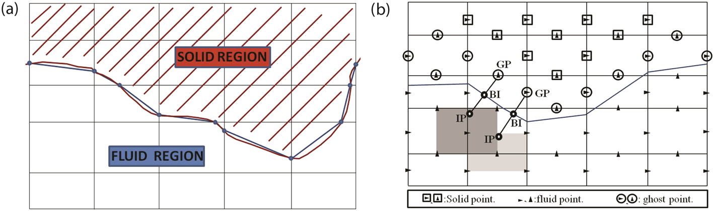

**Figure 1.** (a) The brown polygonal line represents the immersed boundary, and in the model, it is approximated by the blue polygonal line, formed by the intersection points between the brown polygon and the cell interfaces. (b) Schematic description of the ghost-cell methodology in Mittal et al. [32] applied to a staggered grid without modification. The figure shows an immersed boundary cutting through a Cartesian grid. Ghost points, boundary intercepts, and image points are indicated GP, BI, and IP, respectively. The light gray areas denote the stencils used for interpolation of the IP corresponding to the u ghost point GP1. The darker gray areas denote the stencils used for interpolation of the IP corresponding to the v ghost point GP2.

the IP is found, the value at the GP is obtained by combining it with the correct boundary condition at boundary intersection (BI). In some cases, the stencil contains a point on land, in which case the boundary condition at the BI must be used instead. The procedure is similar to the one proposed in Altinakar [16] and Mittal et al. [32] for solving the Navier–Stokes equations. However, while in the latter works a collocated grid is used, here, a staggered grid is employed, and u, v, and ζ are located at three different points. So, in principle, the interpolation should be carried out with three different stencils, one for each variable. However, because of staggering and because of the coupling in (12) and (13) and (17) and (18), either the velocity or the adjacent water level can be prescribed on a certain boundary in order to affect the numerical solution inside the domain. Because we want to leave the water surface free to evolve in partially cut cells, the GP computation is carried out only for the along-x and along-y velocity points (Figure 1b). At the immersed boundary, we impose a free-slip boundary condition. This choice is based on the consideration that for open channel and coastal flows, the grid resolution close to the wall is usually too poor to capture the dynamics of the boundary layer. Therefore, a free-slip condition is imposed, and the velocity computed in the cell close to the boundary represents the averaged motion of the boundary layer rather than the boundary itself [34]. However, a free-slip condition on a staggered grid is not straightforward. The free-slip condition reads as follows:

\[
\begin{aligned}
u_{n,\mathrm{BI}}&=0\ \Rightarrow\ u_{n,\mathrm{GP}}=-u_{n,\mathrm{IP}} &&\text{(Dirichlet condition)},\\
\frac{\partial u_{t,\mathrm{BI}}}{\partial n}&=0\ \Rightarrow\ u_{t,\mathrm{GP}}=u_{t,\mathrm{IP}} &&\text{(Neumann condition)}.
\end{aligned}
\]

where un and ut are the velocities normal and parallel to the boundary, respectively. For both GPs and IPs, the following holds:

\[
\begin{bmatrix}n_x&n_y\\-n_y&n_x\end{bmatrix}\begin{bmatrix}u\\v\end{bmatrix}=\begin{bmatrix}u_n\\u_t\end{bmatrix},
\qquad
u_n=u n_x+v n_y,\quad u_t=-u n_y+v n_x.
\]

where (nx, ny) are the components of the normal to the boundary. Therefore, by substituting the previous equations into the free-slip condition, we find that the velocity at the GP can be computed from the one at the IP by using the following expressions:

\[
u_{\mathrm{GP}}=-u_{\mathrm{IP}}(n_x^2-n_y^2)-2v_{\mathrm{IP}}n_xn_y
\tag{19}
\]

\[
v_{\mathrm{GP}}=v_{\mathrm{IP}}(n_x^2-n_y^2)-2u_{\mathrm{IP}}n_xn_y
\tag{20}
\]

where the identity \(n_x^2+n_y^2=1\) has been used. The problem has therefore reduced to finding the velocities at IPs. The previous equations are easily applicable if the along-x and along-y velocities are available at the same location, and therefore, the same BI and IP and normal (nx, ny) can be used, which is not the case in Figure 1b. Therefore, we decide to interpolate v at the u location, and vice versa. We used a bilinear interpolation, and the v-velocity is computed at the u-point by using the four v-velocity points surrounding the u-point, and vice versa for the u-velocity at the v-point (see uint in Figure 2a). However, when one of the four surrounding points is a GP, the value is not known yet (see stencil for vint in Figure 2a). We use as a first guess for the value at the GP the average of the adjacent velocity points having the same x or y coordinates. Iterations are needed to find the values at the GPs, as described at the end of this section.

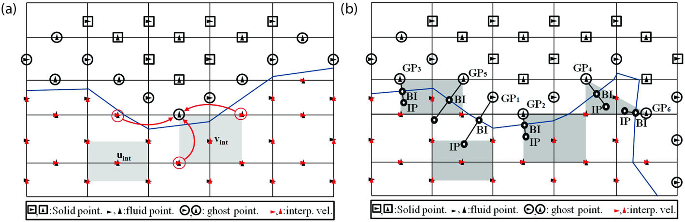

**Figure 2.** (a) Sketch of the interpolation procedure. The v-velocities at u points are obtained by bilinear interpolation from the velocity at v points in the indicated gray stencil. For the velocity vint, the upper left point of the stencil consists in a ghost point, and therefore, its first guess is computed by the average of the adjacent velocity points. (b) The figure shows an immersed boundary cutting through a Cartesian grid and identifies particular ghost points that form the basis for discussion in this section. GP, BI, and IP denote ghost point, boundary intercept, and image point, respectively. The gray areas denote the stencils used for interpolation of the image points.

Four different configurations arise when interpolating the IP from the relevant stencils (Figure 2b):

#### All four points on the fluid side

This is the simplest case (ghost point GP1 in Figure 2b). The values in the IP can be obtained by a bilinear interpolation using the values in the four surrounding corners:

\[
\phi_{\mathrm{ip}}=C_1x_{\mathrm{ip}}y_{\mathrm{ip}}+C_2x_{\mathrm{ip}}+C_3y_{\mathrm{ip}}+C_4.
\]

where φ is either u or v. Thus, the following linear system has to be solved:

\[
\begin{bmatrix}
x_1y_1&x_1&y_1&1\\
x_2y_2&x_2&y_2&1\\
x_3y_3&x_3&y_3&1\\
x_4y_4&x_4&y_4&1
\end{bmatrix}
\begin{bmatrix}C_1\\C_2\\C_3\\C_4\end{bmatrix}
=\begin{bmatrix}\phi_1\\\phi_2\\\phi_3\\\phi_4\end{bmatrix}.
\]

for both u and v. This can be carried out for each vertical layer k, with the subscript k ignored for the sake of clarity.

#### One point on ghost side

In this case (ghost point GP2 in Figure 2b), the condition at the BI is used instead of the ghost point. The velocity components at a point (x, y) can be written as

\[
u=C_{1x}xy+C_{2x}x+C_{3x}y+C_{4x}
\tag{21}
\]

\[
v=C_{1y}xy+C_{2y}x+C_{3y}y+C_{4y}
\tag{22}
\]

At the BI point of coordinates (xBI, yBI), we have

\[
\begin{aligned}
u_n&=u n_x+v n_y\\
&=\left[C_{1x}x_{\mathrm{BI}}y_{\mathrm{BI}}+C_{2x}x_{\mathrm{BI}}+C_{3x}y_{\mathrm{BI}}+C_{4x}\right]n_x\\
&\quad+\left[C_{1y}x_{\mathrm{BI}}y_{\mathrm{BI}}+C_{2y}x_{\mathrm{BI}}+C_{3y}y_{\mathrm{BI}}+C_{4y}\right]n_y=0,\\
\frac{\partial u_t}{\partial n}&=\nabla(-u n_y+v n_x)\cdot n=0.
\end{aligned}
\]

The interpolation coefficients are therefore determined by the following:

\[
MC=U,
\qquad
M=\begin{bmatrix}
x_1y_1&0&x_1&0&y_1&0&1&0\\
0&x_1y_1&0&x_1&0&y_1&0&1\\
x_2y_2&0&x_2&0&y_2&0&1&0\\
0&x_2y_2&0&x_2&0&y_2&0&1\\
x_{\mathrm{BI}}y_{\mathrm{BI}}n_x&x_{\mathrm{BI}}y_{\mathrm{BI}}n_y&x_{\mathrm{BI}}n_x&x_{\mathrm{BI}}n_y&y_{\mathrm{BI}}n_x&y_{\mathrm{BI}}n_y&n_x&n_y\\
-y_{\mathrm{BI}}n_xn_y-x_{\mathrm{BI}}n_y^2&y_{\mathrm{BI}}n_x^2+x_{\mathrm{BI}}n_xn_y&-n_xn_y&n_x^2&-n_y^2&n_xn_y&0&0\\
x_4y_4&0&x_4&0&y_4&0&1&0\\
0&x_4y_4&0&x_4&0&y_4&0&1
\end{bmatrix},
\]
\[
C=\begin{bmatrix}C_{1x}\\C_{1y}\\C_{2x}\\C_{2y}\\C_{3x}\\C_{3y}\\C_{4x}\\C_{4y}\end{bmatrix},
\qquad
U=\begin{bmatrix}u_1\\v_1\\u_2\\v_2\\0\\0\\u_4\\v_4\end{bmatrix}.
\]

#### Two points on ghost side

In this case (ghost point GP3 in Figure 2b), the two BI points, indicated with (xA, yA) and xB, yB), are used instead of the two GPs. The velocity components at a point (x, y) can again be written as in (21) and (22), and the interpolation coefficients are determined by the following:

\[
MC=U,
\qquad
M=\begin{bmatrix}
x_1y_1&0&x_1&0&y_1&0&1&0\\
0&x_1y_1&0&x_1&0&y_1&0&1\\
x_2y_2&0&x_2&0&y_2&0&1&0\\
0&x_2y_2&0&x_2&0&y_2&0&1\\
x_Ay_An_{xA}&x_Ay_An_{yA}&x_An_{xA}&x_An_{yA}&y_An_{xA}&y_An_{yA}&n_{xA}&n_{yA}\\
-y_An_{xA}n_{yA}-x_An_{yA}^2&y_An_{xA}^2+x_An_{xA}n_{yA}&-n_{xA}n_{yA}&n_{xA}^2&-n_{yA}^2&n_{xA}n_{yA}&0&0\\
x_By_Bn_{xB}&x_By_Bn_{yB}&x_Bn_{xB}&x_Bn_{yB}&y_Bn_{xB}&y_Bn_{yB}&n_{xB}&n_{yB}\\
-y_Bn_{xB}n_{yB}-x_Bn_{yB}^2&y_Bn_{xB}^2+x_Bn_{xB}n_{yB}&-n_{xB}n_{yB}&n_{xB}^2&-n_{yB}^2&n_{xB}n_{yB}&0&0
\end{bmatrix},
\]
\[
C=\begin{bmatrix}C_{1x}\\C_{1y}\\C_{2x}\\C_{2y}\\C_{3x}\\C_{3y}\\C_{4x}\\C_{4y}\end{bmatrix},
\qquad
U=\begin{bmatrix}u_1\\v_1\\u_2\\v_2\\0\\0\\0\\0\end{bmatrix}.
\]

#### Two points on ghost side and one on the fluid side

In this special and uncommon case (ghost point GP4 in Figure 2b), one of the four points in the stencil is a solid point. A three-point linear interpolation is used instead of the bilinear interpolation. The velocity components at a point (x, y) are now written as follows:

\[
\begin{aligned}
u&=C_{1x}x+C_{2x}y+C_{3x},\\
v&=C_{1y}x+C_{2y}y+C_{3y}.
\end{aligned}
\]

and the interpolation coefficients are determined by the following:

\[
MC=U,
\qquad
M=\begin{bmatrix}
x_1&0&y_1&0&1&0\\
0&x_1&0&y_1&0&1\\
x_An_{xA}&x_An_{yA}&y_An_{xA}&y_An_{yA}&n_{xA}&n_{yA}\\
-n_{xA}n_{yA}&n_{xA}^2&-n_{yA}^2&n_{xA}n_{yA}&0&0\\
x_Bn_{xB}&x_Bn_{yB}&y_Bn_{xB}&y_Bn_{yB}&n_{xB}&n_{yB}\\
-n_{xB}n_{yB}&n_{xB}^2&-n_{yB}^2&n_{xB}n_{yB}&0&0
\end{bmatrix},
\]
\[
C=\begin{bmatrix}C_{1x}\\C_{1y}\\C_{2x}\\C_{2y}\\C_{3x}\\C_{3y}\end{bmatrix},
\qquad
U=\begin{bmatrix}u_1\\v_1\\0\\0\\0\\0\end{bmatrix}.
\]

Once the velocities at the IP are found, the corresponding velocities at the GP are found with Equation (19) if GP is a v-point, or with Equation (20) if GP is a u-point. In summary, the overall steps to find the velocity values at the GPs are as follows:

1. Interpolate the values of v at the u location and vice versa (Figure 2a). For the stencil containing also one or more GPs, a first guess of the value at the GP is taken as the average of the

adjacent velocity points having the same x or y coordinates.

2. Find the velocities u and v at the IP, by using the proper procedure described earlier for each

of the cases shown in Figure 2b.

3. Compute the corresponding velocities at the GP with Equation (19) if GP is a v-point, with

Equation (20) if GP is a u-point.

4. A corrected value at the GP is found, and the procedure is repeated from step 2 until the

difference between the old and new value is small. Usually, about 6–7 iterations are needed to reach a convergence of up to six significant digits in all the GPs. Other simplified procedures not involving iterations could be devised, but testing different approaches is outside the scope of this paper.

### 3.2. The ghost-cell method in the alternating direction implicit framework

It is not trivial to adapt our ADI-type method to a ghost-cell methodology. If a fully implicit approach is sought, as in Mittal et al. [32], an ADI-type approach is not applicable because in the coupled systems (12) and (13) and (17) and (18), the water level in a particular row/column of the Cartesian domain also depends on the velocity points (and therefore on the water surface point via the momentum equation) in the adjacent row/column. Therefore, the matrix of the system (12) and (13) and (17) and (18) would not be tridiagonal. As for the uncoupled momentum equations (10) and (16), the linear system would not be guaranteed to have a characteristic matrix with 11 diagonals. Later, we describe an approach that applies the ghost-cell method to our ADI framework and guarantees stable and mass-conserving solutions, even when very small cut cells are present.

#### 3.2.1. Ghost-cell treatment for the uncoupled momentum equation.

For the uncoupled momentum equations (10) and (16), we explicitly prescribe the value of the velocities at the GPs. However, at each iteration step of the Red Black Jacobi iterative scheme for solving the uncoupled momentum equations, we recompute the values at the GPs only for the quantities that are treated implicitly. This procedure seems not to affect the stability of the scheme in the test cases performed by the authors. Moreover, no noticeable impact on the number of iterations needed to reach convergence is observed. Note that the values of velocities at the GPs only influence advective terms and horizontal diffusion. The latter is only included (implicitly) in the uncoupled momentum equations (10) and (16) and neglected in the coupled equations (13) and (18). With this approach, all the terms in the uncoupled momentum equations are discretized with a second order of accuracy, except for the gradient of water surface. In fact, because the continuity equation is discretized by means of a mass-conservative finite volume approach, the computed water surface approximates with second order of accuracy the value at the gravity center of the cut cell, not at the cell center. However, the gradient of water surface in the momentum equations (10) and (16) is discretized with a second-order central difference, which uses the values located at the center of the whole cell, not the cut cell. Therefore, the value at the center of the cut cell (e.g., A and B in Figure 3a) has to be extrapolated to the center of the entire cell (A’ and B’ in Figure 3a). Because the surface gradient is treated explicitly, no extra difficulty is added, and the correction can be directly performed on the water surface at the old time step by means of a least square reconstruction (Appendix A).

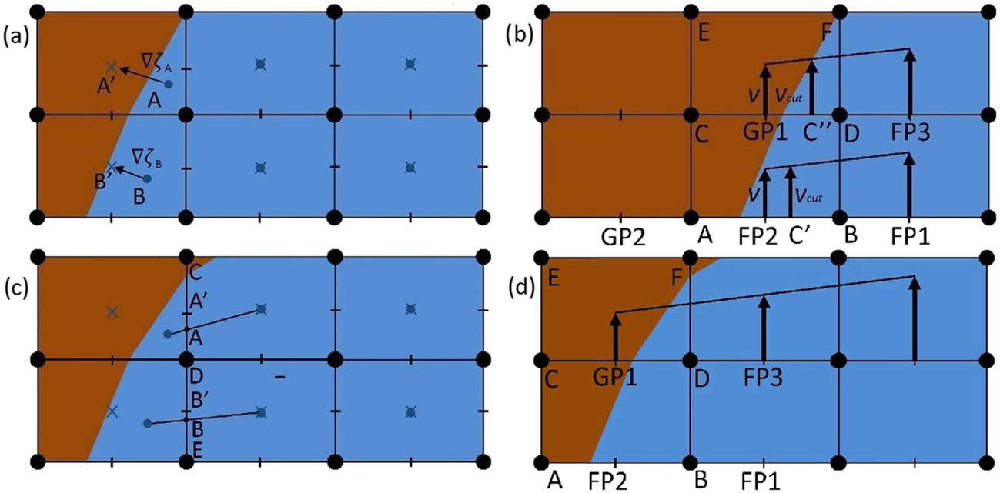

**Figure 3.** (a) Second-order extrapolation of water surface from center of cut cells (A and B) to cell center (A′ and B′) by use of gradients of water surface ∇ζ A and ∇ζ B reconstructed at cut-cell centers (Equation (A1) in Appendix A). Blue dots and blue crosses indicate the center of cut cell and the center of the entire grid cell, respectively. (b) Velocity interpolation at a partially active edge with a ghost point (DC), and at a partially active edge with a fluid point (AB). The velocity is interpolated from the center of the full edge (FP2 and GP1) to the center of the active part of the edge (C′ and C"). GP and FP indicates the ghost and fluid velocity points, respectively. (c) Second-order interpolation of water depth and bed elevation from the center of the cut cells to the center of the active edges. (d) Linear interpolation of the advective terms ∂v/∂y and ∂v/∂x (represented by arrows) from the values of the adjacent velocity points.

#### 3.2.2. Mixed cut-cell/ghost-cell treatment for the coupled continuity and momentum equations.

We first show in Section 3.2.2.1 the approach used to achieve a first order of accuracy. With the modifications presented in Section 3.2.2.2, a second order of accuracy is obtained.

##### 3.2.2.1. First-order method.

Ghost point treatment does not present particular difficulties for the coupled momentum equations. In Equations (13) and (18), in fact, because of the coupling with the continuity equation, the derivatives in the advection terms are at the old time level, and, consistently, also the values at the GPs are computed explicitly. When solving the coupled systems (12) and (13) and (17) and (18), the expression for the velocity is obtained from the momentum equation and substituted into the continuity equation. The continuity equation is then solved for the water surface. In order to ensure mass conservation during this step, two modifications are performed. First, the fluxes through the partially dry edges are modified by only considering the active part of the edge. Second, the area of the cell is reduced, and again, only the wet part is considered. Once these two modifications are performed, mass is conserved up to machine precision. Finally, for the 3D case, at each time step, a weighted average is performed between the vertical velocity in a small cell (i.e., with percentage of active wet area <25%) and the adjacent cell with the largest active area. The weight is given by the active area of the cell, so that global mass conservation is preserved. Also, local mass conservation is ensured, if one now considers as the local control volume the total area of the small cell plus the adjacent. This simple approach largely improves the stability of the scheme, because in very small cells, a small error in computing the horizontal velocity could imply a large error in the vertical velocity.

##### 3.2.2.2. Extension to second order of accuracy.

In order to reach a second order of accuracy, a few extra modifications have to be performed. First, the value of water surface at the center of the cut cell has to be extrapolated to the center of the whole cell, in order to approximate the gradient of water surface in Equations (13) and (18) with second-order accuracy. Any attempt to do this by means of explicit corrections, as it is carried out for the uncoupled momentum equations (Section 3.2.1), lead to unstable solutions. We instead devised a partially implicit approach based on a least square gradient reconstruction (Appendix A). This guarantees a stable solution also when small cut cells are present. Note, however, that in this

case, the computation of the tridiagonal system has to be iterated to convergence for both accuracy and stability. In general, about 10 iterations guarantee convergence up to six significant digits. Moreover, while the momentum equations are discretized at velocity points located at the center of the cell edges (e.g., FP2 and GP1 in Figure 3b), the velocity at the center of active cut edges (e.g., points C’ and C" in Figure 3b) has to be computed with a second order of accuracy in order to maintain the same accuracy for the water fluxes. Therefore, the velocity at the center of the active (i.e., cut) edge vcut is linearly interpolated by using the adjacent fluid and GPs (Figure 3b). In practice, a corrective term (v - vcut) is computed and added to both sides of the discretized equation (Appendix B). Note that the coupling of momentum with the continuity equation implicitly links the velocity to the gradient of water surface on the two adjacent cells (e.g., in Figure 3a, the velocity on the edge CD is coupled with the gradient of water surface between cells ABDC and CDEF). Therefore, while for the uncoupled momentum equation the velocity was forced at cut edges with active part smaller than 50%, for the coupled equations, it should be allowed to evolve in order to ensure mass conservation. Also, the water depth and bed elevation have to be interpolated at the center of the active edge. This has to be carried out whenever an edge is adjacent to at least a cut cell, even if the edge is not cut (e.g., edge DE in Figure 3c). First, a second-order-accurate value is linearly interpolated at the intersection points between the edge and the segment joining the center of the cut cells (points A and B in Figure 3c); then the values at the center of the cut edges (A′ and B′ in Figure 3c) are linearly interpolated (or extrapolated) from the values at the intersection points. We finally need to interpolate the advective terms at the cut edges with active part lower than 50%, whenever the stencil is reduced and it is not possible to reach a second order of accuracy. For example, there is a GP available on the left of FP2, which is needed to compute a second-order central approximation for the derivative, while there is no point on the left of GP1, because GP1 is itself a GP (Figure 3b). In this case, we linearly extrapolate the relevant terms from the adjacent edges as in Figure 3d. Because for the coupled momentum equations the advection terms are computed explicitly, no extra difficulty is added. We will numerically prove in Section 4.2 that our scheme is second-order accurate, both locally and globally.

## 4. Results

In this section, three different test cases are presented where the flow boundaries are not aligned with the Cartesian grid. If available, an analytical solution is taken as reference, otherwise a numerical solution on a curvilinear boundary-fitted grid is used. In what follows, ‘Cartesian’ solution refers to the solution obtained with a Cartesian structured grid without the immersed boundary technique applied; ‘immersed boundary’ solution refers to the solution that is obtained when the immersed boundary approach as described in the previous section is used on a Cartesian structured grid. Theoretically, the ADI method is unconditionally (linearly) stable [35]. However, advective terms are linearized, and therefore, nonlinear instabilities can occur for very large time steps. Moreover, the splitting of the spatial operator in two directions combined with the presence of boundaries determines an upper bound for the Courant number of \(4\sqrt{2}\) [35]. This basically means that a free-surface wave cannot travel passed two bends of 90° in one complete ADI time step. That value is a lower bound, which occurs in the unrealistic case of a narrow channel (1 cell wide) that makes an angle of 45° with the Cartesian grid [25]. In most realistic simulations, the Courant number can be safely increased to a value of 10 [35]. In the following test cases, relatively large time steps are used, corresponding to a maximum Courant number for wave propagation larger than 1, unless otherwise stated. The actual values are reported in each section, and they are determined as a compromise between computational speed and accuracy of the solution. Finally, in all the following test cases, a mass conservation check has been performed, and mass was always conserved up to machine precision.

### 4.1. Uniform flow in a straight channel

In this section, we compute the flow in an open channel which banks, in plan view, are inclined with respect to the computational grid lines. The angle of the channel with the x-axis is taken equal to β = tan(43/80). In this way, the geometry of the partially active cells is different along the channel. The downstream boundary condition for the water depth is h = 4 m. The Chezy number equals

65 m1/2 s-1. The unit-width water discharge qs equals 5 m2 s-1 at the upstream boundary, where s

is the along-channel coordinate. Note that qs = ush and us = 1.25 ms-1 is the along-s water velocity of the uniform flow. The channel width is equal to 500 cos(β) m. The bed slope is the uniform slope

\[
S=\left(\frac{q_s}{C h^{3/2}}\right)^2.
\]

Because a free-slip boundary condition is applied at the banks, the equilibrium solution of the 2D problem reduces to a one-dimensional uniform flow. Figure 4 shows a comparison of the results obtained with and without the immersed boundary modification. Note that the distance between the immersed banks has been chosen in such a way that the total planar area of the channel is the same in both approaches. The simulation using the standard Cartesian grid predicts depth variations in both the transversal and longitudinal direction, while the immersed boundary simulation predicts a more uniform water depth in both directions. The same considerations apply for the velocity, and the errors in velocity for the Cartesian solution are particularly large close to the bank. Figure 5 shows the comparison between the computed water level and velocity and the analytical solution in the channel centerline. It appears that when the immersed boundary method is used, the solution is very close to the reference, whereas the standard Cartesian approach introduces errors. The classical Cartesian approach tends to overestimate the water depth upstream and underestimate it downstream. Therefore, a model based on a very coarse grid could predict a wrong likelihood of inundation of a given flood. These results arise because an incorrect zig-zag discretization of the straight channel boundary introduces an extra error in the discretization of the hydrodynamic equations. A 3D simulation has also been run on the same computational domain, using seven layers in the vertical. Note that the analytical solution strictly applies only to a 2D problem, or to a 3D problem with uniform vertical distribution of flow along-s velocities. In order to obtain a uniform flow solution, a periodic boundary condition is applied, for which the upstream water depth at the first cell inside the domain is copied downstream at the boundary cell. The exact solution consists of a uniform flow everywhere. Again, the simulation using the standard Cartesian grid predicts depth and velocity variations in both directions, while the immersed boundary simulation predicts a more uniform flow (Figure 6). The differences between the two solutions are evident in Figure 7, where a comparison in the channel centerline is shown. The algebraic closure of turbulence introduced in Section 2.1 leads to an analytical logarithmic velocity profile and a parabolic viscosity profile for a uniform steady flow. Figure 8 shows the vertical distribution of the horizontal velocity and turbulent viscosity for both the immersed boundary method and the standard Cartesian grid, respectively. The immersed boundary solution very well reproduces the analytical solution both in the centerline and close to the bank, while the Cartesian solution shows a noticeable departure from the analytical one, the error being larger close to the bank. In both the 2D and 3D test cases, a relatively large time step of 30 s has been used, corresponding to a Courant number equal to 12, and no sign of instability has been noticed while progressing toward the equilibrium solution. Finally, note that the same Cartesian simulation has also been run with a horizontal channel perfectly aligned with the Cartesian grid. The computed water surface and water velocity are indistinguishable from the exact solution and are not shown here for the sake of clarity. Therefore, the errors of the standard Cartesian simulations in Figures 4–8 are entirely due to the error in the discretization of the bank geometry, rather than to the inaccuracy of the numerical discretization of the terms in the governing equations.

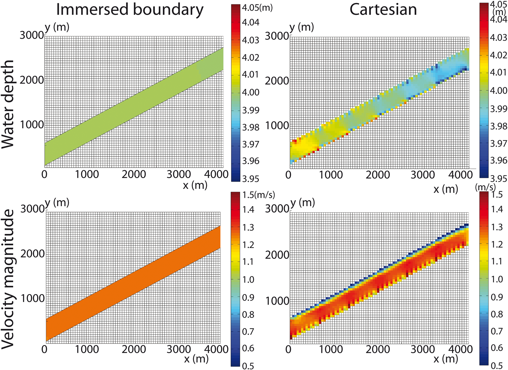

**Figure 4.** 2D uniform flow in a straight channel. Plan view of water depth (top) and velocity (bottom) in the channel. Left: solution obtained using the immersed boundary method; right: solution obtained using the standard Cartesian grid, in which a zig-zag discretization of the boundary is unavoidable.

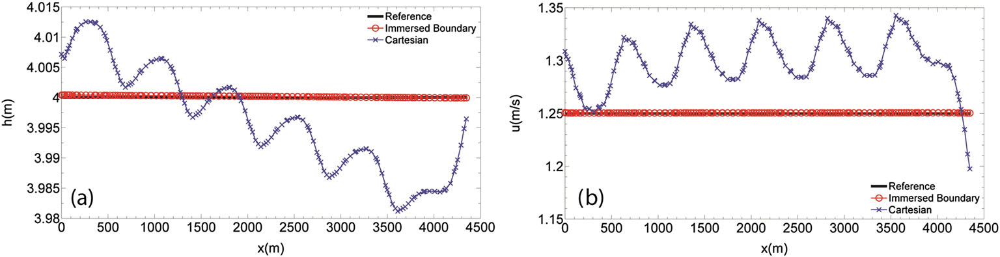

**Figure 5.** (a) Water depth and (b) magnitude of flow velocity in the centerline for a 2D uniform flow in a straight channel. Black line is the 2D analytical solution; red line is the immersed boundary method solution; and blue line is the solution using a standard Cartesian discretization.

### 4.2. Flow in an annular channel

In this section, we solve the flow in an annular channel, for both a 2D and 3D discretization. For the 2D case, we compare the numerical solutions with the analytical solution proposed by Horrit [36]. Under the hypothesis of steady flow and negligible turbulent diffusion (and therefore a free-slip condition at the wall), the shallow water equations in radial coordinates read as follows:

\[
\begin{aligned}
g\frac{d\zeta}{dr}-\frac{v_\theta^2}{r}&=0,\\
\frac{g}{r}\frac{dz_0}{d\theta}+\frac{gv_\theta^2}{C^2h}&=0.
\end{aligned}
\]

where r is the radius of curvature, θ is the angle that a point forms with the x-axis (measured clockwise; Figure 9), and C is the Chezy coefficient of friction. If we assume a constant friction

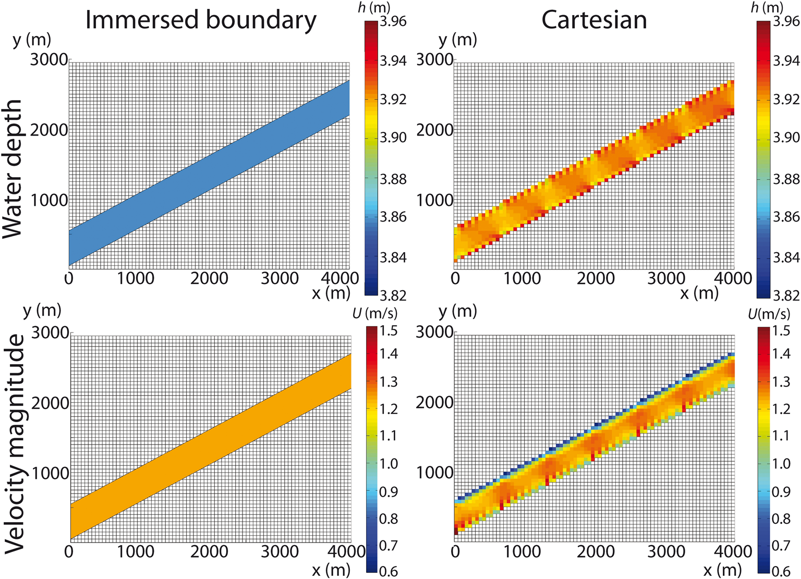

**Figure 6.** Computed solutions of water depth (top) and depth-averaged velocity magnitude (bottom) for 3D uniform flow in a straight channel (plan view). Left: solution obtained using the immersed boundary method. Right: solution obtained using the standard Cartesian grid.

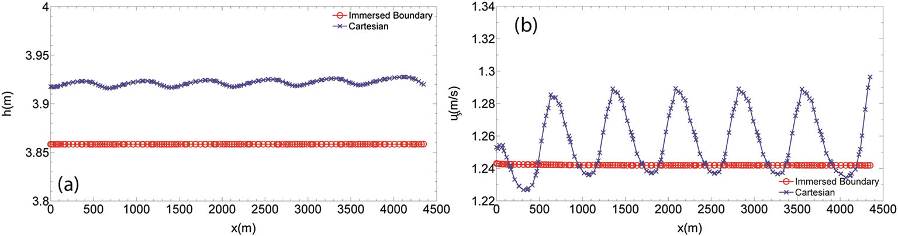

**Figure 7.** (a) Water depth and (b) magnitude of the depth-averaged flow velocity in the centerline for a 3D uniform flow in a straight channel. Red line is the immersed boundary method solution; blue line is the solution using a standard Cartesian discretization.

\[
h=D\exp\left[\frac{C^2}{gr}\frac{dz_0}{d\theta}\right]
\tag{23}
\]

\[
v_\theta=\sqrt{-\frac{dz_0}{d\theta}\frac{DC^2}{r}\exp\left[\frac{C^2}{gr}\frac{dz_0}{d\theta}\right]}
\tag{24}
\]

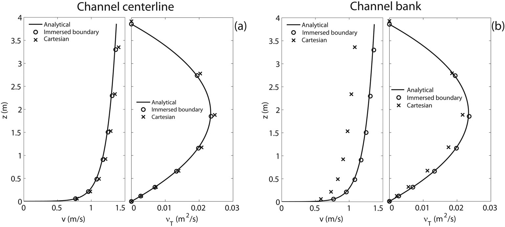

**Figure 8.** Computed vertical distribution of the horizontal velocity and turbulent viscosity along the centerline (a) and at a grid point next to the bank (b) of the channel shown in Figure 6. Circles and crosses indicate solutions by the immersed boundary method and the standard Cartesian discretization, respectively. The continuous lines represent the logarithmic and parabolic analytical solutions for horizontal velocity and turbulent viscosity, respectively.

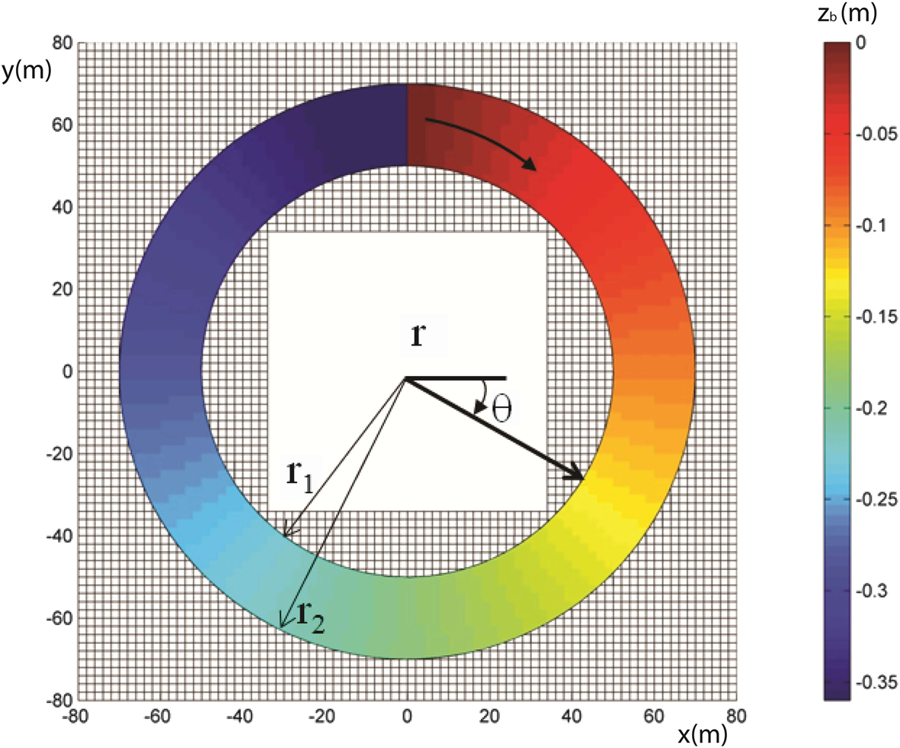

**Figure 9.** Sketch of the geometry and notation for the annular test case. The bed elevation and the Cartesian grid are also shown.

D is a constant that is computed numerically up to desired precision by imposing the following:

\[
Q=\int_{r_1}^{r_2}v_\theta h\,dr.
\]

where r1 and r2 are the radius of curvature of the channel at the inner and outer banks, respectively. A channel with a width of 20 m and inner radius of 50 m is considered. The grid resolution of the Cartesian structured grid is 2 × 2 m, giving approximately 10 grid cells per channel width. Note that in order to accommodate boundary conditions, in the upper part of the domain, the grid is slightly coarser in the x direction (Figure 9). The down-reach slope at the centerline is taken equal to -0.001, such that dz/dθ = - 0.06 m rad-1. The Chezy friction coefficient is set equal to 40 m1/2 s-1

and the flow discharge equal to 40 m3 s-1. A time step of 1.2 s has been used, corresponding to a Courant number of about 15. The initial condition consists of quiescent water, with a water level equal to 1 m everywhere. The two ends of the channel coincide in the northern part of the domain. Note that water flows in a clockwise direction. The boundary conditions consist of imposed flow discharge at the upstream end. A periodic boundary condition for water depth is applied at the other end, where the water depths are constrained to be equal to those at the first cells at the upstream boundary. In order to obtain an axisymmetric solution, also the velocity tangential to the boundary is made periodic. Finally, the percentage of exiting discharge at each downstream cell is used to distribute the prescribed discharge in each cell of the upstream boundary. Figure 10 shows the results obtained using the three different approaches. The curvilinear grid provides an axisymmetrical solution for both velocity and water depth. The solution using the classical Cartesian grid presents a strong deviation from symmetry, with peaks and depressions in both water depth and velocity. A big improvement is obtained by using the proposed immersed boundary approach, in which solution for both depth and velocity is symmetrical. If the flow is 3D, no analytical solution can be found. We therefore use the 3D solution on a curvilinear grid as the reference solution. Figure 11 shows the results obtained with the different approaches by using seven discrete layers on the vertical. The secondary current forming in the bend [37] moves the velocity maximum from the inner to the outer bend, as it can be seen in the reference solution. The immersed boundary method provides an axisymmetrical solution similar to the reference solution. In the curvilinear grid, the peak and the trough of velocity concentrate in the last cell close to the wall, whereas in the immersed boundary method, they are smeared over a couple of cells. The classical Cartesian approach fails to produce an axisymmetrical solution, and in particular, it cannot capture the shift of velocity maximum toward the outer bank. Figure 12 shows the computed velocity magnitudes and directions in a cross section of the channel. Both the immersed boundary and reference solutions present a maximum of velocity on the outer bank close to the surface, while the Cartesian mesh provides a maximum of velocity in the upper part of the water column but toward the middle of the section. The secondary current in the cross section, with water flowing toward the outer bend at the surface and toward the inner bend at the bottom, is well captured in all three solutions (arrows in Figure 12).

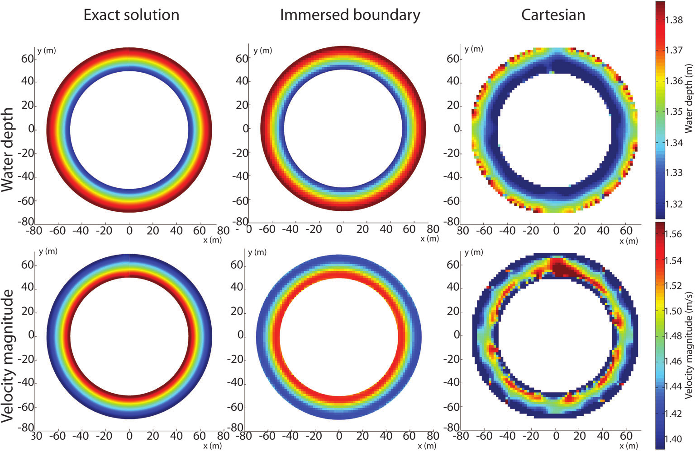

**Figure 10.** 2D results for a periodic annular channel. A comparison between a curvilinear grid (left), a Cartesian grid with immersed boundary (center), and a standard Cartesian grid (right) is shown. Upper line: water level. Lower line: velocity magnitude.

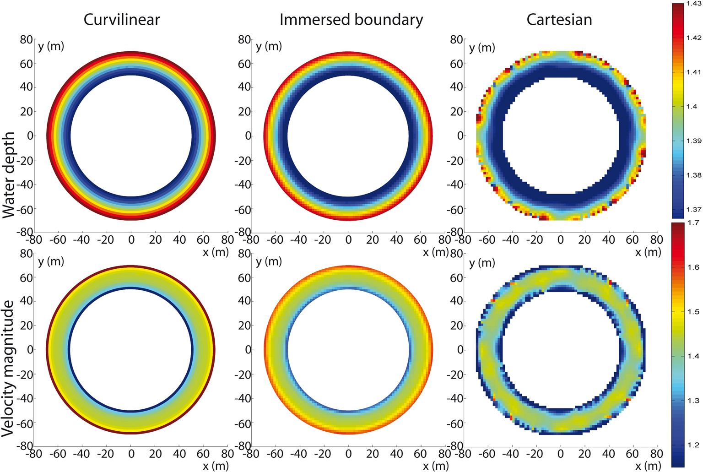

**Figure 11.** 3D results for a periodic annular channel. A comparison between a curvilinear grid (left), a Cartesian grid with immersed boundary (center), and a standard Cartesian grid (right) is shown. Upper line: water level. Lower line: velocity magnitude.

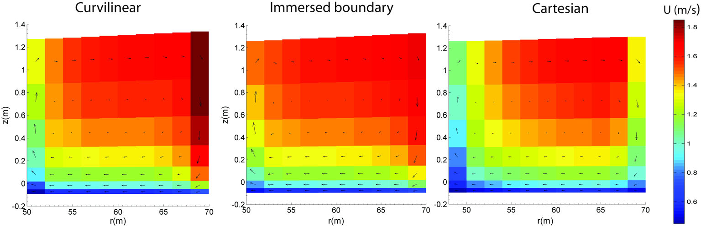

**Figure 12.** Velocity magnitude in a section at 145° in the clockwise direction from the upstream boundary. The vectors indicate the direction of the velocity vector once projected into the section.

Mass is preserved up to machine precision in both the 2D and 3D test cases. We want to stress that a few cells have a very small active area, about 10-5 times the total cell area. These cells do not give any stability problem for both the 2D and 3D simulations. We want also to stress the importance of combining the ghost-cell approach for the momentum equations with a cut-cell approach for the continuity equation. Figure 13 shows for the 2D case that our hybrid cut-cell/ghost-cell method is more accurate than a classical ghost-cells method applied to the momentum equations and also is more accurate than a simple cut-cell method applied to the continuity equation. By combining the two approaches, we obtain a solution that is smoother near the boundaries and closer to the analytical solution. Similar results apply for the 3D case (not shown). Finally, we examine the spatial accuracy of the solver. The flow field has been computed on a hierarchy of grids (40 × 40, 80 × 80, 160 × 160, and 320 × 320). We would like to stress that only for this accuracy test, the normal derivative of tangential velocity at the wall has not been set to zero but to the actual derivative of the solution at the wall computed with Equation (24). Comparing the 2D numerical solution with the exact solution allows us to compute the L2 and Lmax error norms.

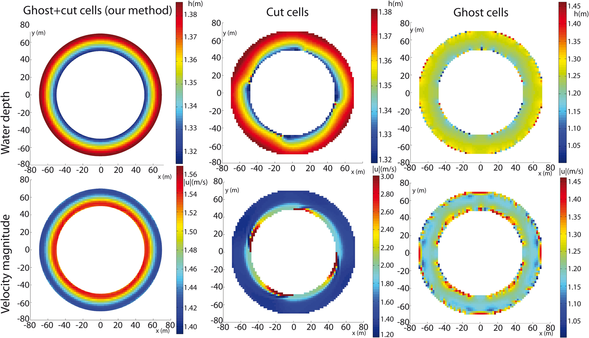

**Figure 13.** Water depth (upper row) and velocity magnitude (lower row) for the 2D annular test case. From left to right, the hybrid cut-cell/ghost-cell method, the cut-cell method for the continuity equation, and the ghost-cell method for the momentum equations are shown.

The results for both the along-x velocity and the water surface are shown in Table I. Similar values are computed for the along-y velocity but are not shown. Both error norms show that our hybrid cut-cells/ghost-cells method with second-order extension (HCG2 in Table I) has an order of accuracy of about 2 in both L2 and Lmax norms. Note that the L2 error norm is a good measure of the global (i.e., average) error, whereas the Lmax norm captures the maximum local error, usually located around the immersed boundary (not shown). Therefore, our method is both globally and locally second-order accurate. Table I also shows the values of the norms and the orders of accuracy for HCG1, which is the firstorder version of our hybrid scheme (i.e., without the extra modifications in Section 3.2.2.2 and without the water surface extrapolation in Figure 3a). It is evident that the local accuracy drops to 0.75–1, and this in turn affects the global error, which drops to about 1–1.5. However, we would like to stress that for the coarser grids (40 × 40 and 80 × 80, corresponding to 5 and 10 grid cells per channel width, respectively), the HCG1 and HCG2 errors, especially the velocity errors, are not much different. This indicates that the first order of the scheme is still suitable for hydrodynamic applications not requiring much detail in the flow field and for long-term morphodynamic simulations. Some extra computational effort is needed in order to reach a second-order accuracy (Section 3.2.2.2), in particular the coupled continuity and momentum equations have to be iterated to convergence. Therefore, the final choice between first and second orders of the scheme should be based on the sought balance between accuracy and computational cost. The results for the classical Cartesian approach are also shown in Table I, indicating a convergence rate close to 0.3–0.7 in norm L2 and close to 0 (or even slightly negative) in norm Lmax. This is not surprising, because for a staircase boundary and a velocity field pointing away from the wall, the order of accuracy of the advective terms is lowered to 0 or 1 respectively for the first and the second grid point inside the domain [35]. Therefore, we conclude that both the first and second order version of our method largely reduces the errors and increases the convergence rate compared with the standard Cartesian approach.

### 4.3. Dam break in a straight channel not aligned with the grid lines

In the previous sections, only steady-state solutions have been presented. Here, a comparison with an unsteady analytical solution is performed. As in Section 4.1, a straight channel has been used, forming an angle equal to tan(43/80) with the x-axis. The initial condition consists of quiescent

**Table I.** L2 and Lmax error norms and orders of accuracy for the along-x velocity \(u\) and water surface \(\zeta\) using successive grid refinements.

| Quantity | Norm | HCG2 | Order | HCG1 | Order | Cartesian | Order | Grid size |
|---|---:|---:|---:|---:|---:|---:|---:|---|
| \(u\) | \(L_2\) | 0.001305 |  | 0.001771 |  | 0.183525 |  | \(\Delta x\) |
| \(u\) | \(L_2\) | 0.000197 | 2.73 | 0.001147 | 0.62 | 0.171680 | 0.09 | \(\Delta x/2\) |
| \(u\) | \(L_2\) | 0.000038 | 2.37 | 0.000504 | 1.18 | 0.132953 | 0.36 | \(\Delta x/4\) |
| \(u\) | \(L_2\) | 0.000008 | 2.24 | 0.000250 | 1.00 | 0.112632 | 0.23 | \(\Delta x/8\) |
| \(u\) | \(L_2\) | 0.000002 | 1.98 | 0.000118 | 1.07 | 0.090447 | 0.31 | \(\Delta x/16\) |
| \(u\) | \(L_{\max}\) | 0.008444 |  | 0.007647 | 0.00 | 0.946143 | 0.00 | \(\Delta x\) |
| \(u\) | \(L_{\max}\) | 0.001530 | 2.46 | 0.005896 | 0.37 | 1.906449 | -1.01 | \(\Delta x/2\) |
| \(u\) | \(L_{\max}\) | 0.000385 | 1.98 | 0.003962 | 0.57 | 1.241945 | 0.61 | \(\Delta x/4\) |
| \(u\) | \(L_{\max}\) | 0.000093 | 2.05 | 0.002773 | 0.51 | 1.358997 | -0.12 | \(\Delta x/8\) |
| \(u\) | \(L_{\max}\) | 0.000024 | 1.97 | 0.001676 | 0.72 | 1.411942 | -0.05 | \(\Delta x/16\) |
| \(\zeta\) | \(L_2\) | 0.0004314 |  | 0.003810 |  | 0.082236 |  | \(\Delta x\) |
| \(\zeta\) | \(L_2\) | 0.0000883 | 2.28 | 0.001361 | 1.48 | 0.021197 | 1.95 | \(\Delta x/2\) |
| \(\zeta\) | \(L_2\) | 0.0000245 | 1.85 | 0.000459 | 1.56 | 0.007292 | 1.53 | \(\Delta x/4\) |
| \(\zeta\) | \(L_2\) | 0.0000042 | 2.54 | 0.000161 | 1.50 | 0.006758 | 0.10 | \(\Delta x/8\) |
| \(\zeta\) | \(L_2\) | 0.0000009 | 2.30 | 0.001824 | 1.40 | 0.004135 | 0.70 | \(\Delta x/16\) |
| \(\zeta\) | \(L_{\max}\) | 0.0017010 |  | 0.023900 |  | 0.122773 |  | \(\Delta x\) |
| \(\zeta\) | \(L_{\max}\) | 0.0002459 | 2.79 | 0.012645 | 0.91 | 0.104740 | 0.22 | \(\Delta x/2\) |
| \(\zeta\) | \(L_{\max}\) | 0.0000665 | 1.88 | 0.006924 | 0.86 | 0.066854 | 0.64 | \(\Delta x/4\) |
| \(\zeta\) | \(L_{\max}\) | 0.0000158 | 2.07 | 0.003389 | 1.03 | 0.061907 | 0.11 | \(\Delta x/8\) |
| \(\zeta\) | \(L_{\max}\) | 0.0000034 | 2.23 | 0.001824 | 0.89 | 0.055402 | 0.16 | \(\Delta x/16\) |

HCG2 is the second-order hybrid cut-cell/ghost-cell method; HCG1 is the first-order version. The results for the Cartesian approach with staircase boundaries are also shown.

water and of a constant water level equal to 5 m on the southwest part of the channel, and equal to

1 m in the northeast part. Therefore, a discontinuity in the water level is present in the central section

of the channel. A horizontal bed level equal to 0 m is prescribed, and bed friction is neglected. Because of the free-slip condition at the walls, the 2D problem reduces to a one-dimensional problem. Its analytical solution was first proposed by Stoker [38], and it is often used to test the ability of numerical models to deal with discontinuities in the flow field ([39–42], among others). For this test case, the advective terms are discretized explicitly in both ADI stages, following the momentum-conserving approach proposed by Stelling and Duinmeijer [20], which leads to the

\[
\frac{\Delta t\,u_{\max}}{\Delta x}<1,\qquad \frac{\Delta t\,v_{\max}}{\Delta y}<1.
\]

where umax and vmax are the maximum velocities achieved in x and y directions, respectively. A time step of 0.6 s has been used in this simulation. A planar view of the solution after 152 s is shown in Figure 14. While the solution given by the Cartesian grid displays cross-sectional variations in both the velocity and the water depth, the variations are much smaller when an immersed boundary method is used. Figure 15 shows the computed longitudinal profiles in the axis of the channel, together with the analytical solution. The immersed boundary grid gives better results than the Cartesian grid, and the latter shows some spurious peaks of water level and velocity.

### 4.4. Tidal wave in a meandering channel

Here, another unsteady test case is presented, consisting of a tidal wave with amplitude a = 2.5 m prescribed at the mouth of a meandering tidal channel (Figure 16). The geometry is inspired by a similar test case proposed by Canestrelli et al. [43]. The channel is 400 m wide, and it is formed by an initial 8.8-km-long straight reach connecting to a meandering reach (Figure 16). Downstream,

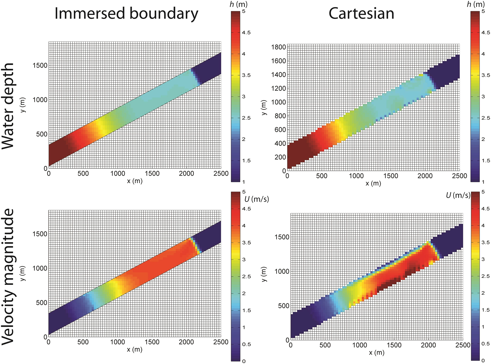

**Figure 14.** Dam break in a straight channel. Plan view of water depth (top) and velocity (bottom) in the channel. Left: solution obtained using the immersed boundary method; right: solution obtained using the standard Cartesian grid.

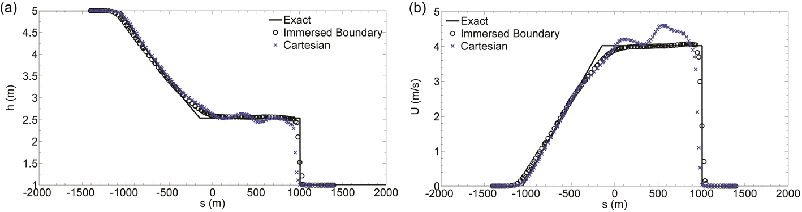

**Figure 15.** (a) Water depth and (b) magnitude of flow velocity computed in the centerline of the channel by the immersed boundary grid and the Cartesian grid. The analytical solution is also shown. The origin of the coordinate s is located at the initial position of the discontinuity.

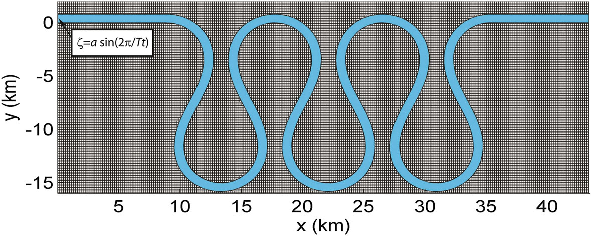

**Figure 16.** The geometry of the meandering tidal channel is shown. The blue area indicates the channel, which is immersed in a Cartesian structured grid. The tidal water level is prescribed on the left, while the right end has a no-flux boundary condition.

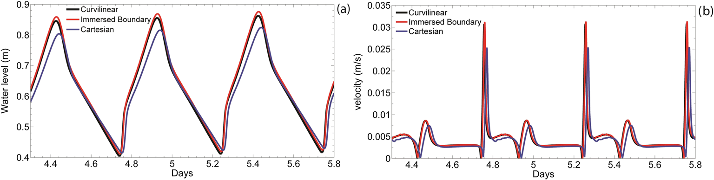

**Figure 17.** 2D results for a meandering tidal channel. The time series are plotted at a distance of 1 km from the landward end of the channel. (a) Water level and (b) magnitude of flow velocity.

the channel ends with another 8.8-km-long straight reach. Following Leopold et al. [44], regular meanders are used; that is, the third harmonic components, responsible for the fattening and skewing of meander lobes, are set to zero. The expression for the angle that the tangent to the channel axis forms with the axis x reads as follows:

\[
\theta=\theta_0\cos\left(\frac{2\pi}{\lambda}s\right)
\tag{25}
\]

where s is an intrinsic curvilinear coordinate starting at the beginning of the meandering reach, θ0 is the angle at s = 0 m, and λ is the intrinsic wavelength. Three meanders generated by Equation (25) with θ0 = 115° and λ = 1000 m are connected to the two straight reaches (Figure 16). The grid resolution is 160 m by 160 m, while the width of the channel equals 800 m. The bed elevation is set everywhere equal to -10 m, and the Chezy coefficient is taken equal to 40 m1/2 s-1. A constant turbulent viscosity (ν2D = 1 m2 s-1) has been used for the horizontal diffusive terms. On the left boundary, a semidiurnal tide with period T = 12 h and amplitude a = 2.5 m has been prescribed, and on the right boundary, a no-flux condition is assumed. The 3D version of the model has been used, with seven layers on the vertical. A time step of 30 s has been used, which implies a Courant number equal to about 5. Figure 17 shows the water level and the velocity versus time at a point at 1 km from the no-flux end. The immersed boundary solution closely follows the reference solution computed on a curvilinear grid. For both the velocity and the water level, the Cartesian solution displays a phase lag and underestimates the peaks. We want to note that a very coarse grid is used, and by successive refinements, we verified that the solutions on a Cartesian grid, both with and without the immersed boundary modification, tend to the solution on the curvilinear grid.

## 5. Conclusions

In this work, an immersed boundary method has been proposed to solve the 2D and 3D shallow water equations. The method has been implemented for a staggered grid and an alternative direction implicit time discretization. A hybrid cut-cell/ghost-cell method is used: Ghost cells are used for the momentum equations in order to prescribe the correct boundary condition at the immersed boundary, while cut cells are used in the continuity equation in order to conserve mass. The resulting scheme is robust, does not suffer any time step limitation for small cut cells, conserves fluid mass up to machine precision, and displays second order of spatial accuracy, both locally and globally. The model allows for further developments. In particular, the proposed approach is being extended to include both bed load and suspended load, and thus to allow vertical changes of bed elevation. In the future, our research will focus on developing a robust approach to reproduce movable banks, in a way that the hydraulic geometry of a channel can then be varied both vertically and laterally.

## Appendix A

In order to discretize the gradients of water surface with second-order accuracy, the value of water surface ζ cut at the center of the cut cell (blue dots in Figure 3b) has to be extrapolated to the value of water surface ζ cell at the center of the grid cell (blue crosses in Figure 3b), because ζ cell is used in the momentum equations, while ζ cut is used in the continuity equation. To this purpose, we first compute the cell-centered gradient ∇ζ cell = (∂ζ /∂x, ∂ζ /∂y) by means of a least square reconstruction. The latter is computed for the cell (i, j) by minimizing the square of the distance between the known and reconstructed cell-centered values of water surface in the cell (i, j) and the adjacent ones (iA, jA). By indicating with Nij the set of cells sharing an edge with cell (i, j) and with (xG, yG) the barycenter of the cut cell, the reconstruction reads as follows:

\[
\begin{aligned}
\frac{\partial\zeta}{\partial x}
&=-\frac{\frac{\partial\zeta}{\partial y}\sum\limits_{i_A,j_A\in N_{ij}}(x_G^{i_A,j_A}-x_G^{i,j})(y_G^{i_A,j_A}-y_G^{i,j})-\sum\limits_{i_A,j_A\in N_{ij}}(x_G^{i_A,j_A}-x_G^{i,j})(\zeta_{i_A,j_A}^{\mathrm{cut}}-\zeta_{i,j}^{\mathrm{cut}})}{\sum\limits_{i_A,j_A\in N_{ij}}(x_G^{i_A,j_A}-x_G^{i,j})^2},\\
\frac{\partial\zeta}{\partial y}
&=\frac{-\frac{\sum\limits_{i_A,j_A\in N_{ij}}(x_G^{i_A,j_A}-x_G^{i,j})(y_G^{i_A,j_A}-y_G^{i,j})}{\sum\limits_{i_A,j_A\in N_{ij}}(x_G^{i_A,j_A}-x_G^{i,j})^2}\sum\limits_{i_A,j_A\in N_{ij}}(x_G^{i_A,j_A}-x_G^{i,j})(\zeta_{i_A,j_A}^{\mathrm{cut}}-\zeta_{i,j}^{\mathrm{cut}})+\sum\limits_{i_A,j_A\in N_{ij}}(y_G^{i_A,j_A}-y_G^{i,j})(\zeta_{i_A,j_A}^{\mathrm{cut}}-\zeta_{i,j}^{\mathrm{cut}})}{\sum\limits_{i_A,j_A\in N_{ij}}(y_G^{i_A,j_A}-y_G^{i,j})^2-\frac{\left[\sum\limits_{i_A,j_A\in N_{ij}}(x_G^{i_A,j_A}-x_G^{i,j})(y_G^{i_A,j_A}-y_G^{i,j})\right]^2}{\sum\limits_{i_A,j_A\in N_{ij}}(x_G^{i_A,j_A}-x_G^{i,j})^2}}.
\end{aligned}
\]

which can be rewritten as follows:

\[
\begin{cases}
\dfrac{\partial\zeta}{\partial x}=\displaystyle\sum_{i_A,j_A\in N_{ij}}a_{i,j}^{i_A,j_A}\,\Delta\zeta_{i_A,j_A},\\
\dfrac{\partial\zeta}{\partial y}=\displaystyle\sum_{i_A,j_A\in N_{ij}}b_{i,j}^{i_A,j_A}\,\Delta\zeta_{i_A,j_A}.
\end{cases}
\]

where \(a_{i,j}^{i_A,j_A}\) and \(b_{i,j}^{i_A,j_A}\) are constants depending only on the grid geometry, and \(\Delta\zeta_{i_A,j_A}=\zeta_{i,j}^{\mathrm{cut}}-\zeta_{i_A,j_A}^{\mathrm{cut}}\) are the jumps in water surface between cell \((i,j)\) and the adjacent cell. We can then write the sought linear extrapolation as follows:

\[
\Delta\zeta_{i,j}=\zeta_{i,j}^{\mathrm{cut}}-\zeta_{i,j}^{\mathrm{cell}}
=\frac{\partial\zeta}{\partial x}\left(x_{G,\mathrm{cc}}^{i,j}-x_G^{i,j}\right)
+\frac{\partial\zeta}{\partial y}\left(y_{G,\mathrm{cc}}^{i,j}-y_G^{i,j}\right)
=\sum_{i_A,j_A\in N_{ij}}c_{i,j}^{i_A,j_A}\,\Delta\zeta_{i_A,j_A}
\tag{A1}
\]

where \(c_1\) and \(c_{i,j}^{i_A,j_A}\) are constants. For the uncoupled momentum equations (10) and (16), the extrapolation (A1) is entirely explicit and does not present any extra difficulty. For the coupled momentum equations (13) and (18), the gradient of water surface at the velocity points is implicit, and extra care has been taken, because using an explicit extrapolation would make the scheme unstable. Discretization of the along-x momentum

\[
a_{i+1/2,j}\zeta_{i,j}^{\mathrm{cell}}+b_{i+1/2,j}u_{i+1/2}+c_{i+1/2,j}\zeta_{i+1,j}^{\mathrm{cell}}=d_{i+1/2,j}.
\]

Because \(\zeta_{i,j}^{\mathrm{cell}}=\zeta_{i,j}^{\mathrm{cut}}+\Delta\zeta_{i,j}\), we have

\[
a'_{i+1/2,j}\zeta_{i,j}^{\mathrm{cut}}+b'_{i+1/2,j}u_{i+1/2,j}+c'_{i+1/2,j}\zeta_{i+1,j}^{\mathrm{cut}}=d'_{i+1/2,j}
\tag{A2}
\]

where

\[
\begin{aligned}
a'_{i+1/2,j}&=a_{i+1/2,j}\left(1+c_{i,j}^{i+1,j}\right)-c_{i+1/2,j}c_{i+1,j}^{i,j},\\
c'_{i+1/2,j}&=c_{i+1/2,j}\left(1+c_{i+1,j}^{i,j}\right)-a_{i+1/2,j}c_{i,j}^{i+1,j},\\
d'_{i+1/2,j}&=d_{i+1/2,j}+a_{i+1/2,j}\left(c_{i,j}^{i-1,j}\Delta\zeta_{i-1,j}+c_{i,j}^{i,j+1}\Delta\zeta_{i,j+1}+c_{i,j}^{i,j-1}\Delta\zeta_{i,j-1}\right)\\
&\quad+b_{i+1/2,j}\left(c_{i+1,j}^{i+2,j}\Delta\zeta_{i+2,j}+c_{i+1,j}^{i+1,j+1}\Delta\zeta_{i+1,j+1}+c_{i+1,j}^{i+1,j-1}\Delta\zeta_{i+1,j-1}\right).
\end{aligned}
\]

In Equation (A2), only the term containing the jump at edge \(i+\frac{1}{2},j\) is kept implicit, while we moved to the right-hand side the other terms, which are recomputed at each iteration until convergence is reached.

With this approach, the stability of the scheme is ensured, because the velocity at edge \(i+\frac{1}{2},j\) is implicitly linked to the jump in water surface between the right and the left cells. Moreover, this procedure preserves the second order of accuracy. An analogous procedure is used for the along-y momentum equation (18).

## Appendix B

Discretization of the along-x momentum equation (13) at the center of the cell edge (i + 1/2, j), after the surface gradient correction described in Appendix A, gives

\[
a'_{i+1/2,j}\zeta_{i,j}+b'_{i+1/2,j}u_{i+1/2}+c'_{i+1/2,j}\zeta_{i+1,j}=d'_{i+1/2,j}
\tag{B1}
\]

where \(a'_{i+1/2,j}\), \(b'_{i+1/2,j}\), \(c'_{i+1/2,j}\), and \(d'_{i+1/2,j}\) are the discretization coefficients. Velocity and water surfaces on the left-hand side are all at time n + 1/2. We add to both the sides of the previous equation the corrective term:

\[
b_{i+1/2,j}\left(u_{i+1/2}^{\mathrm{cut}}-u_{i+1/2}\right)
\tag{B2}
\]

where \(u_{i+1/2}^{\mathrm{cut}}\) is the velocity at the center of the cut edge (e.g., C' and C'' in Figure 3b) and is computed by linear interpolation as described in Section 3.2.2.2. We take the term (B2) implicitly on the left-hand side and explicitly (i.e., at time \(n\)) on the right-hand side, so that (B1) reads as follows:

\[
a'_{i+1/2,j}\zeta_{i,j}+b'_{i+1/2,j}u_{i+1/2}^{\mathrm{cut}}+c'_{i+1/2,j}\zeta_{i+1,j}=d''_{i+1/2,j}
\tag{B3}
\]

with

\[
d''_{i+1/2,j}=d'_{i+1/2,j}+b_{i+1/2,j}\left(u_{i+1/2}^{n,\mathrm{cut}}-u_{i+1/2}^{n}\right).
\]

In this way, system (B3) is solved for the velocity at the center of the active edge. When (B3) is substituted in the discretized continuity equation (12), it provides second-order accurate fluxes, as long as depths and bed elevations are interpolated as in Figure 3c. An analogous procedure is used for the along-y momentum equation (18) at stage 2.

## Acknowledgements

Alberto Canestrelli and Rudy Slingerland were supported by FESD/EAR-1135427. The first author would like to thank Asel Umarova for proofreading part of the paper and correcting several errors.

## References

1. Anastasiou K, Chan CT. Solution of the 2D shallow water equations using the finite volume method on unstructured

triangular meshes. International Journal for Numerical Methods in Fluids 1997; 24(11):1225–1245.

2. Fujihara M, Borthwick AGL. Godunov-type solution of curvilinear shallow-water equations. Journal of Hydraulic

Engineering ASCE 2000; 126(11):827–836.

3. Bandringa H. Immersed boundary methods. MSc Thesis, University of Groningen, the Netherlands, 2010.

4. Mittal R, Iaccarino G. Immersed boundary methods. Annual Review of Fluid Mechanics 2005; 37:239–261.

5. Popinet S. Gerris: a tree-based adaptive solver for the incompressible Euler equations in complex geometries.

Journal of Computational Physics 2003; 190:572–600.

6. Zheng L, Hedrick TL, Mittal R. Time-varying wing-twist improves aerodynamic efficiency of forward flight in

butterflies. PloS One 2013; 8(1):e53060.

7. Mittal R, Zheng X, Bhardwaj R, Seo JH, Bielamowicz S. Toward a simulation-based tool for the treatment of vocal

fold paralysis. Frontiers of Physics 2011; 2:1–15.

8. Seo JH, Mittal R. A coupled flow-acoustic computational study of bruits from a modeled stenosed artery. Medical &

Biological Engineering Computing, 2012; 50(10):1025–1035.

9. Zheng X, Seo JH, Vedula V, Abraham T, Mittal R. Computational modeling and analysis of intracardiac flows in

simple models of the left ventricle. European Journal of Mechanics - B/Fluids 2012; 35:31–39.

10. An H, Yu S. Well-balanced shallow water flow simulation on quadtree cut cell grids. Advances in Water Resources

2012; 39:60–70.

11. Causon DM, Ingram DM, Mingham CG, Yang G, Pearson RV. Calculation of shallow water flows using a Cartesian

cut cell approach. Advances in Water Resources 2000; 23(5):545–562.

12. Causon DM, Ingram DM, Mingham CG. A Cartesian cut cell method for shallow water equations with moving

boundaries. Advances in Water Resources 2001; 24:889–911.

13. Ingram DM, Causon DM, Mingham CG. Developments in Cartesian cut cell methods. Mathematics and Computing

in Simulation 2003; 61:5,61–72.

14. Kim H-J, Lee JW, Cho Y-S. Numerical simulation of shallow-water flow using the modified Cartesian cut-cell

approach. Journal of Engineering Mechanics 2010; 136(3):399–404.

15. Liang Q, Zang J, Borthwick AGL, Taylor PH. Shallow flow simulation on dynamically adaptive cut-cell quadtree

grids. International Journal for Numerical Methods in Fluids 2007; 53(12):1777–1799.

16. Altinakar M. DSS-WISE simulation-based decision support system for water infrastructural security – DSS WISE

project final report, National Center For Computational Hydroscience And Engineering, Technical Report No. NCCHE-TR-2008-11, 2008.

17. Altinakar MS, McGrath MZ, Ozeren Y, Miglio E. Representation of linear terrain features in a 2D flood model with

regular Cartesian mesh. Proceedings of the 2009 World Environmental & Water Resources (EWRI) Congress, ASCE, May 16–23, 2009, Kansas City, Missouri, 2009.

18. Liang Q, Borthwick AGL. Simple treatment of non-aligned boundaries in a Cartesian grid shallow flow model.

International Journal for Numerical Methods in Fluids 2008; 56(11):2091–2110.

19. Seo JH, Mittal R. A sharp-interface immersed boundary method with improved mass conservation and reduced

spurious pressure oscillations. Journal of Computational Physics 2011; 230–19:7347–7363.

20. Stelling GS, Duinmeijer SPA. A staggered conservative scheme for every Froude number in rapidly varied shallow

water flows. International Journal for Numerical Methods in Fluids 2003; 43:1329–1354.

21. Leendertse JJ. Aspects of a computer model for long period water-wave propagation. RAND Corporation Memorandum RM-5294-PR, 1967.

22. Casulli V, Zanolli P. Semi-implicit numerical modeling of nonhydrostatic free-surface problems for environmental

problems. Mathematical and Computer Modelling 2002; 36:1131–1149.

23. Casulli V, Stelling GS. Numerical simulation of 3D quasi-hydrostatic free-surface flows. Journal of Hydraulic

Engineering 1998; 124(7):678–686.

24. Casulli V. A semi-implicit finite difference method for nonhydrostatic, free-surface flows. International Journal for

Numerical Methods in Fluids 1999; 30:425–440.

25. Deltares. Delft3D-FLOW: simulation of multi-dimensional hydrodynamic flows and transport phenomena, including sediments – user manual, 614 pp., Deltares, Delft, Netherlands, 2014, online at http://oss.deltares.nl/documents/183920/185723/Delft3D-FLOW_User_Manual.pdf .

26. Uittenbogaard RE, van Kester JATM, Stelling GS. Implementation of three turbulence models in 3D-TRISULA for

rectangular grids. Tech. Rep. Z81, WL|Delft Hydraulics, Delft, The Netherlands, 1992.

27. Nezu I, Nakagawa A. Turbulence in Open Channel Flows. IAHR Monograph Series, Balkema: Rotterdam, 1993.

28. Rodi W. Turbulence models and their application in hydraulics. In A State of the Art Review (3rd edn). Balkema AA:

Rotterdam, Netherlands, Essex, England, 1993.

29. Bakhmetev BA. Hydraulics of open channels. Eng. Soc. Monograph. McGraw-Hill, 1932.

30. Stelling GS, Wiersma AK, Willemse JBTM. Practical aspects of accurate tidal computations. Journal of Hydraulic

Engineering 1986; 112(9):802–817.

31. Stelling GS, Leendertse JJ. Approximation of convective processes by cyclic AOI methods. In M. L. Spaulding, K.

Bedford and A. Blumberg, eds., Estuarine and coastal modeling, Proceedings 2nd Conference on Estuarine and Coastal Modelling, ASCE, pages 771–782 1992. Tampa.

32. Mittal R, Dong H, Bozkurttas M, Najjar FM, Vargas A, von Loebbecke A. A versatile sharp interface immersed

boundary method for incompressible flows with complex boundaries. Journal of Computational Physics 2008; 227(10):4825–52.

33. Spruyt A, Mosselman E, Jagers B. A New Approach to River Bank Retreat and Advance in 2D Numerical Models of

Fluvial Morphodynamics, RCEM2011. Tsinghua University Press: Beijing, 2011.

34. Lekien F, Haller G. Unsteady flow separation on slip boundaries. Physics of Fluids 2008; 20:1–19.

35. Stelling GS. On the construction of computational methods for shallow water flow problems. Tech. Rep. 35,

Rijkswaterstaat, 1983.

36. Horritt MS. Evaluating wetting and drying algorithms for finite element models of shallow water flow. International

Journal for Numerical Methods in Engineering 2002; 55:835–851.

37. Rozovskii IL. Flow of water in bends of open channels, Academy of Sciences of the Ukrainian SSR, Kiev

(translated from Russian by the Israel Program for Scientific Translations, Jerusalem, 1961), 1957, 233 pp.

38. Stoker JJ. Water Waves. Interscience: New York, 1957.

39. Canestrelli A, Toro EF. Restoration of the contact surface in FORCE-type centered schemes II: non conservative

one- and two-layer two-dimensional shallow water equations. Advances in Water Resources 2012a; 47:76–87.

40. Canestrelli A, Fagherazzi S, Lanzoni S. A mass-conservative centered finite volume model for solving twodimensional two-layer shallow water equations for fluid mud propagation over varying topography and dry areas.

Advances in Water Resources 2012b; 40:54–70.

41. Canestrelli A, Siviglia N, Dumbser M, Toro EF. Well-balanced high-order centered schemes on unstructured

meshes for shallow water equations with fixed and mobile bed. Advances in Water Resources 2010; 33:291–303.

42. Canestrelli A, Siviglia N, Dumbser M, Toro EF. Well-balanced high-order centred schemes for non-conservative

hyperbolic systems. Applications to shallow water equations with fixed and mobile bed. Advances in Water Resources 2009; 32:834–844.

43. Canestrelli A, Toro EF. Restoration of the contact surface in FORCE-type centered schemes I: homogeneous

two-dimensional shallow water equations. Advances in Water Resources 2012c; 47:88–99.

44. Leopold LB, Wolman MG, Miller JP. Fluvial Processes in Geomorphology. W.H. Freeman and Co.: London, 1964;

522.
