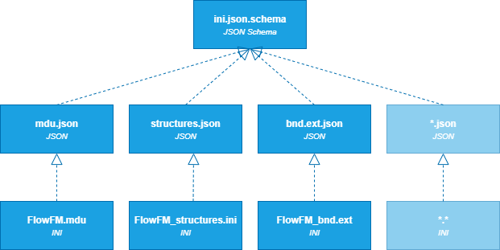
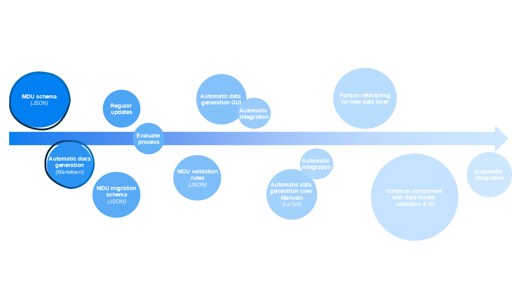

This repository contains the specifications for D-HYDRO kernel input files. The main purpose of these specifications is to improve clarity on the latest file formats and transparency on changes. This formal specification will also facilitate the automation of certain processes, such as updating the user manuals and updating software packages.


**Table of contents**
- [Repository Contents](#repository-contents)
- [Supported Files](#supported-files)
- [Contributing to this repository](#contributing-to-this-repository)
  - [Making changes](#making-changes)
  - [Releasing on GitHub](#releasing-on-github)
    - [Official D-HYDRO release](#official-d-hydro-release)
    - [Intermediate DIMR release](#intermediate-dimr-release)
- [Initiative](#initiative)
  - [Motivation](#motivation)
  - [Requirements \& decisions](#requirements--decisions)
    - [General requirements](#general-requirements)
    - [File Format Requirements](#file-format-requirements)
  - [Vision \& roadmap](#vision--roadmap)


# Repository Contents

Within the `/specifications/dflowfm` folder:
- `*.json`: Specification files describing the structure of D-Flow FM kernel files
- `*.json.schema`: JSON Schema files validating the specification files
- `*.md`: Markdown documentation for each file type



Each kernel file type has a corresponding specification file in JSON defining its structure. For example, `mdu.json` describes the MDU file structure. These files include keywords, descriptions, default values, and more.

Each specification file must conform to a schema that defines its internal structure. For example, `ini.json.schema` validates `mdu.json` and `structures.json`, since an MDU and structure file are both INI files. They ensure consistency and enforceability of the specification format.

# Supported Files
The following D-HYDRO kernel files have a specification:
- [MDU file](specifications/dflowfm/mdu.md)

# Contributing to this repository

Changes to this repository are required when updates happen that affect a D-HYDRO kernel file structure during kernel development.

## Making changes

1. **Clone** this repository
2. **Create a branch** to work on your changes
3. **Make your changes**:
   * If changes are made to a specification file, update the `file_version` property in the file file using [semantic versioning](https://semver.org/).
   * If changes are made to a JSON Schema file, update all relevant JSON files by updating their `file_format_version` property accordingly using semantic versioning.
4. **Create a pull request (PR)** to the `main` branch. The PR must:
     * Include the issue number and a clear description of the changes
     * Be approved by at least two developers before merging
     * Have zero failing checks (defined in the GitHub actions)

5. **Merge using the 'Squash and Merge' method.** Make sure that the commit message includes the issue number and a clear description of the changes.

**Semantic versioning for file versions**
- Semantic versioning is used to indicate the nature of changes:
  - `MAJOR`: breaking changes (renaming/removing keywords)
  - `MINOR`: backwards-compatible changes (adding keywords)
  - `PATCH`: bugfixes or metadata changes (updating descriptions or default values)

## Releasing on GitHub
When a specific set of specification is included in an official or intermediate D-HYDRO release, create a GitHub release for that commit.

### Official D-HYDRO release
1. Check out the desired commit
2. Tag the release (use correct version)

```
git tag -a v2025.01 -m "D-HYDRO 2025.01"
git push origin v2025.01
```

3. Go to the [Releases](https://github.com/Deltares-research/D-HYDRO-file-schematizations/releases) page on GitHub
4. Click `Create a new release` and:
   * Choose the tag you just created (e.g. `v2025.01`)
   * Choose the previous tag (e.g. `v2024.03`)
   * Select `Set as the latest release`
5. Click `Publish release`

### Intermediate DIMR release
1. Checkout the desired commit
2. Tag the release (use correct version)

```
git tag -a v2.27.27 -m "DIMR 2.27.27"
git push origin v2.27.27
```

3. Go to the [Releases](https://github.com/Deltares-research/D-HYDRO-file-schematizations/releases) page on GitHub
4. Click `Create a new release` and:
   * Choose the tag you just created (e.g. `v2.27.27`)
   * Choose the previous tag (e.g. `v2.27.26`)
   * Select `Set as a pre-release`
5. Click `Publish release`


# Initiative

This section outlines the motivation, requirements, design decisions, and long-term vision behind this initiative.

## Motivation

The structure of model files in D-HYDRO changes over time as the source code develops. For users, it is important to know which input is accepted when setting up their models. These structural changes must also be reflected in our user manuals and software that relies on the D-HYDRO kernels.

Currently, the accepted file structures are embedded within the Fortran source code. This creates the following issues:
- The information is not easily accessible to users and developers outside the kernel development team
- Manual effort is required to keep everything in sync
- Consistency has never been achieved between the kernel, the user manuals and our other software

We decided to address these issues by introducing a formal specification for the kernel files.

## Requirements & decisions

### General requirements

All content and its changes must be
- Version-controlled
- Easily accessible
- Versioned
- Human-readable
- Machine-parsable

**Decisions**

- A new central GitHub repository should be introduced
- A specification file should be introduced for each kernel file 
- Each specification file should have the same file format
- Each specification file should be properly versioned  

### File Format Requirements
Based on the decisions above, we had to choose a file format in which the specifications would be defined.
We set up the following requirements:

The file format must have
- A standardized format
- Wide platform and language support
- Human readability and editability
- A standardized schema definition

**Decisions**
- Each kernel file should have a corresponding [JSON](https://www.json.org/json-en.html) file, defining the structure of the kernel file.
- Each JSON file should implement a [JSON Schema](https://json-schema.org/) and should be validated against it.
- For each kernel file format, e.g. INI, there should be one JSON Schema file.
- Each JSON file should define the latest state of the corresponding kernel file
- Each JSON file should have a separate migration mapping defining the migration strategy from version to version

**Considered alternatives**
- **YAML**: Not as widely supported, and lacks widely-supported robust schema validation.
- **XML**: Quickly becomes too verbose and less readable, more complex to write and maintain.
- **TOML**: Not as widely supported, and lacks widely-supported robust schema validation.

## Vision & roadmap

**Vision**

Ultimately, changes to the kernel files only have to be implemented in one place and all dependencies are automatically updated without needing manual interference.
When completely set up, this will save the developers and users a significant amount of time and consistency is ensured between all of our software and documentation.

**Roadmap**



1.  **Initial MDU specification**: Defines all MDU keywords, descriptions, default values, and basic validation.
2.  **Automated documentation generation**: A Markdown document is automatically generated for each commit in the MDU specification and becomes available on GitHub.
3.  **Ongoing development**: The MDU specification is regularly updated during development.
4.  **Process evaluation**: Evaluate and improve the process for updates.
5.  **Migration specification**: Introduce a migration specification to define updates from one MDU version to another.
6.  **Extended validation**: Extend validation rules, including more complex validation for dependencies between MDU data.
7.  **GUI integration**: Convert the MDU specification to a format usable by the GUI (currently CSV).
8.  **Automatic GUI updates**: Changes to the MDU specification trigger automatic updates in the GUI, ensuring that the GUI is always up-to-date with the kernel.
9.  **User manual integration**: Convert the MDU specification to LaTeX for inclusion in user manuals (currently in tables).
10. **Automatic user manual updates**: Changes to the MDU specification trigger automatic updates in the user manuals, ensuring that the user manual is always up-to-date with the kernel.
11. **Fortran code integration**: Prepare the kernel Fortran code for automatic integration of the MDU specification.
12. **Shared software component**: Design and develop a software component that provides an API to handle the converted MDU data model, with built-in validation and IO functionality.
13. **Full integration**: Integrate the common component across all dependencies for automatic updates.
14. **Support for more kernel files**: Add support for more kernel files and carry out integrations.