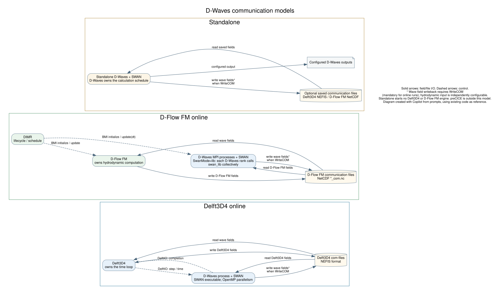
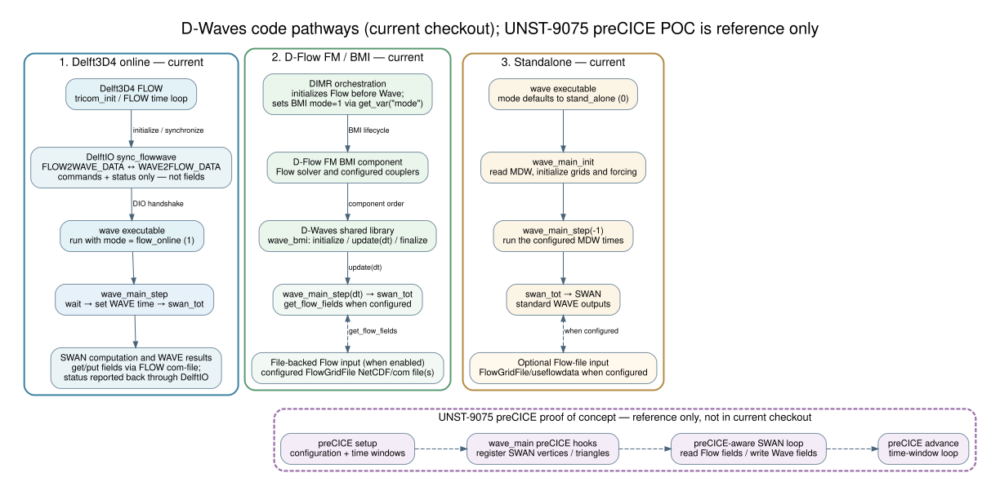

# D-Waves communication models

This documentation explains **who controls time, where fields are exchanged,
and who performs remapping** for the three current execution scenarios.
Implementation links on each page connect those responsibilities to code.

## Available scenarios

| Scenario | Time/control owner | Field channel | Details |
|---|---|---|---|
| Standalone | D-Waves calculation schedule; no live Delft3D4 or D-Flow FM engine | Optional existing Delft3D4 or D-Flow FM com-files | [Standalone model](./D-Waves_pathway_standalone.md) |
| Delft3D4 online | Delft3D4 time loop; DelftIO step commands and completion status | Delft3D4 NEFIS com-files read/written by Delft3D4 and D-Waves | [Delft3D4 model, including mud](./D-Waves_pathway_delft3d4.md) |
| D-Flow FM online | DIMR/BMI lifecycle and component schedule | NetCDF com-files read/written by D-Flow FM and D-Waves | [D-Flow FM model](./D-Waves_pathway_fm_bmi.md) |

In all three cases, D-Waves manages the SWAN computations and maps fields
between the hydrodynamic (Delft3D4 or D-Flow FM) and SWAN grids. In standalone
runs, reading saved hydrodynamic input and writing wave fields
(`[Output] WriteCOM`) are independent choices. **Online runs (modes 1 and 2)
always require `WriteCOM = true`:** otherwise D-Waves aborts during input
checking.

The diagram above is a developer view: it lists the main code entry points of
each pathway side by side. The preCICE panel at the bottom is reference
material only; see the preCICE comparison at the end of this page.

## Communication models

These pathways differ in who controls the calculation schedule and how
hydrodynamic and wave fields move between components. **Control is not field
exchange:** DelftIO (Delft3D4) and DIMR/BMI (D-Flow FM) coordinate execution,
while the com-files carry the gridded fields.

### Delft3D4 online

Delft3D4 owns the simulation time loop. Delft3D4 and D-Waves run as separate
processes. DelftIO carries initialization metadata, step/time commands and
completion status; it does not carry the gridded hydrodynamic or wave fields.
Those fields are read from and, when `WriteCOM` is enabled, written to
Delft3D4 com-files, which use NEFIS. This is a different file format from the
NetCDF communication files used by D-Flow FM. Delft3D4's `FLNcdf` keyword can
make the map, Fourier, history and drogue files NetCDF, but Delft3D4 stops if
`com` (or `all`) is listed for NetCDF output
([rdprfl.f90](../../../flow2d3d/packages/flow2d3d_io/src/input/rdprfl.f90#L162)),
so the com-file used for D-Waves coupling is always NEFIS.

The D-Waves process starts SWAN as a separate executable, which uses OpenMP for
parallel computation. Delft3D4 domain partitioning is separate from SWAN's
OpenMP parallelism. For more on the synchronization and mode-2 water/mud
exchange, see the [Delft3D4 pathway details](./D-Waves_pathway_delft3d4.md).

### D-Flow FM online through DIMR/BMI

DIMR controls the component lifecycle and the update schedule. In the usual
configuration, it initializes D-Flow FM before D-Waves and calls the components
according to the configured schedule. Before initializing D-Waves, DIMR sets
D-Waves' mode through the BMI `mode` variable. The value depends on where
D-Waves appears in the `<control>` section of `dimr_config.xml`:

- D-Waves is a `<start>` inside a `<startGroup>` within a `<parallel>` block,
  with D-Flow FM as the `<parallel>` block's own `<start>` (as in the
  [example configuration](../../../../../examples/dflowfm/08_dflowfm_sequential_dwaves/dimr_config.xml)):
  DIMR sets mode 1 (online).
- D-Waves is a plain `<start>` directly under `<control>`, as the first block
  and outside any `<parallel>` block, so that DIMR drives D-Waves on its own:
  DIMR sets mode 0 (standalone, no D-Flow FM coupling).

A non-blank MDW `[General] FlowFile` forces mode 1 regardless of what DIMR sets.

In the coupled layout, D-Flow FM and D-Waves exchange fields through NetCDF
communication files. BMI controls component execution but does not transfer
gridded fields.

For parallel D-Waves runs configured with `SwanMode=lib`, multiple D-Waves MPI
processes participate in the SWAN solve: the master handles input/output and
mapping, while each D-Waves rank calls `swan_lib` collectively. This
D-Waves/SWAN MPI parallelism is distinct from D-Flow FM partitioning and
DIMR's component schedule. See the
[D-Flow FM/BMI pathway details](./D-Waves_pathway_fm_bmi.md).

### Standalone

Standalone D-Waves owns its calculation schedule and does not start or advance
a Delft3D4 or D-Flow FM engine. It may read saved Delft3D4 NEFIS or D-Flow FM
NetCDF communication files. Reading hydrodynamic fields and writing wave fields
with `WriteCOM` are independent choices; writing fields does not make the run
live coupling. See the
[standalone pathway details](./D-Waves_pathway_standalone.md).

### Shared execution model

- D-Waves prepares both map directions per grid pair at initialization. It
  applies the reverse mapping and writes wave fields only when `WriteCOM`
  enables writeback (always the case online).
- D-Waves visits the SWAN grids in the configured order; nested grids use the
  boundary output of their parent grid. The numbers of Delft3D4 or D-Flow FM
  partitions, SWAN nests and D-Waves ranks are independent of each other.
- In Delft3D4 online runs, SWAN is started as an executable that uses OpenMP.
  In parallel D-Flow FM/BMI runs with `SwanMode=lib`, the D-Waves MPI ranks
  call the SWAN library collectively.

### Configuration and compatibility

| Setting | Role |
|---|---|
| D-Waves mode 0 / 1 / 2 | Standalone / online / classic Delft3D4 water-plus-mud extension. The caller supplies the initial mode (the executable's second argument, default 0; DIMR through the BMI `mode` variable). A non-blank `[General] FlowFile` then forces mode 1, and a non-blank `FlowMudFile` mode 2. Both online engines normally use mode 1. |
| `[General] FlowFile` | MDW switch for online mode (mode 1). Only whether it is non-blank matters; the value is never used as a file path. It does not select the D-Flow FM NetCDF route, although the manual's D-Flow FM example (A.1.3.4.2) also sets it. `FlowMudFile` adds mode 2 within the same parser branch. |
| `[General] ComFile` | Existing Delft3D4 offline runid selection (manual A.1.2). Legacy; read only when `FlowFile` is blank. |
| `[Output] COMFile` | D-Flow FM NetCDF communication-file path (must end in `com.nc`); selects the D-Flow FM file route, including offline use. The old `FlowGridForCom` keyword is no longer supported and aborts the run. |
| Hydrodynamic input selections (`FlowBedLevel`, `FlowWaterLevel`, `FlowVelocity`, ...) | Select which Delft3D4 or D-Flow FM fields D-Waves reads. |
| `[Output] WriteCOM` | Writes wave fields to the communication file(s). Optional in standalone runs; mandatory in modes 1 and 2. |

MDW keywords such as `FlowFile` keep a historical "Flow" prefix and apply to
both Delft3D4 and D-Flow FM; they do not by themselves identify the engine.

Mode alone does not identify the engine. A blank or non-blank
`[Output] COMFile` selects classic DelftIO/NEFIS versus D-Flow FM NetCDF
handling. **Preserve the mode-2 water/mud dependencies for Delft3D4**;
D-Flow FM/BMI does not implement that path.

Configuration reference: [D-Waves User Manual](../include/D-Waves_User_Manual.pdf),
version 2027.01, revision 81307, Sections 3.3.1, 5.4.1.1–5.4.1.2 and 5.4.9
(GUI), Appendices A.1.1 (MDW keywords, including `FlowFile`, `FlowMudFile` and
`WriteCOM`), A.1.2 and A.1.3.4.2. Source links on the scenario pages establish
the implementation behavior.

## Reference comparison: UNST-9075 preCICE proof of concept

The proof-of-concept branch is used here only as a reference for comparison.
Its D-Waves changes are not in the current checkout or main branch and must
not be read as a supported current D-Waves pathway. The reference branch adds
preCICE-specific hooks in its D-Waves manager:

- Its [`wave_main.F90`](https://github.com/Deltares/Delft3D/blob/all/poc/UNST-9075_preCICE_Proof_of_Concept/src/engines_gpl/wave/packages/manager/src/wave_main.F90)
  adds preCICE lifecycle entry points, including `initialize_fm_coupling`,
  `is_fm_coupling_ongoing`, and `advance_fm_time_window`.
- The initialization path reads the SWAN grid from the MDW file and registers
  active vertices and triangles on a preCICE mesh.
- Its [`swan_tot.F90`](https://github.com/Deltares/Delft3D/blob/all/poc/UNST-9075_preCICE_Proof_of_Concept/src/engines_gpl/wave/packages/manager/src/swan_tot.F90)
  passes preCICE state into hydrodynamic-field acquisition and writes selected SWAN
  results (including wave height/direction/period, forces, momentum, and
  dissipation fields) to preCICE.
- The proof-of-concept advances preCICE time windows explicitly. That
  protocol is distinct from the current DelftIO handshake and from DIMR's
  current BMI lifecycle.

The comparison also shows that the D-Waves BMI wrapper and executable source
are not themselves the preCICE adapter: the GitHub blobs for
`wave_bmi.f90` and `wave_exe.f90` have the same IDs on the current branch and
the proof-of-concept branch, while the proof-of-concept changes the manager
and SWAN orchestration path. In the current checkout,
[wave_main.f90](../../packages/manager/src/wave_main.f90) and
[swan_tot.f90](../../packages/manager/src/swan_tot.f90) have no preCICE state
or lifecycle calls. Treat the proof-of-concept as comparison material only,
not as a current implementation or evidence that D-Flow FM/BMI coupling uses
preCICE.
