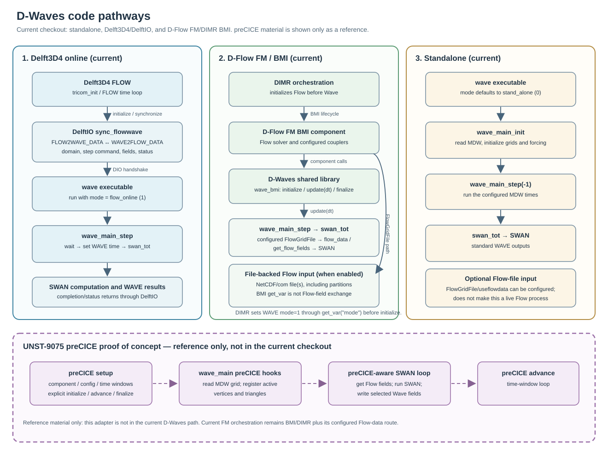

# D-Waves code pathways

This note describes the D-Waves execution paths in the current checkout for
standalone use, Delft3D4 online coupling, and D-Flow FM orchestration through
BMI. It also compares those paths with the
[UNST-9075 preCICE proof-of-concept branch](https://github.com/Deltares/Delft3D/tree/all/poc/UNST-9075_preCICE_Proof_of_Concept).
The diagram is available as [SVG](./dwaves_code_pathways.svg); its Graphviz
source is [DOT](./dwaves_code_pathways.dot).

## At a glance

| Scenario | Entry point | Coordination and data path |
|---|---|---|
| Standalone | `wave` executable (`wave_exe`) | `wave_main` runs SWAN from the MDW schedule. Optional Flow data can be read from configured Flow files. |
| Delft3D4 online | `wave` executable with mode `1`, launched alongside `d_hydro` | Flow and Wave rendezvous and exchange step commands/status through DelftIO (`sync_flowwave`); the model fields themselves are read from and written to FLOW communication (com) files. |
| D-Flow FM / BMI | `wave` shared library, loaded as a DIMR component | DIMR initializes and advances the BMI components. D-Waves uses the MDW `FlowGridFile`/Flow-data path for configured Flow inputs; this is not direct field-array exchange through the Wave BMI `get_var` interface. |

The `stand_alone`, `flow_online`, and `flow_mud_online` mode values are `0`,
`1`, and `2`, respectively, in
[wave_data.f90](../../packages/data/src/wave_data.f90). The executable defaults
to mode `0`; its optional second command-line argument overrides the mode.
The BMI library starts with an unset mode and must be given a mode before its
`initialize` entry point is called.

## Standalone

1. The `wave` executable in
   [wave_exe.f90](../../packages/wave/src/wave_exe.f90) parses the MDW filename
   and optional mode. With no mode argument it uses `0`.
2. It calls `wave_main_init`, then `wave_main_step(-1)`, then
   `wave_main_finish` in
   [wave_main.f90](../../packages/manager/src/wave_main.f90).
3. Initialization reads the MDW input, configures SWAN grids and grid maps,
   and prepares any configured external forcing. The manager calls
   `swan_tot` to stage SWAN input, run SWAN, and consume its results.
4. In mode `stand_alone`, the step runs the MDW-specified SWAN times and
   finalization releases the SWAN and forcing resources.

Standalone does not require a live Flow process. It can nevertheless be
configured to use existing Flow data: when `FlowGridFile` and the relevant
MDW options are set, `flow_init` can read the configured NetCDF Flow files
even in standalone mode. This file-backed option is distinct from online
Delft3D4 communication.

Relevant implementation: [wave_exe.f90](../../packages/wave/src/wave_exe.f90),
[wave_main.f90](../../packages/manager/src/wave_main.f90), and
[flow_data.f90](../../packages/data/src/flow_data.f90).

Detailed diagram (actual subroutine calls and module-level state):
[dwaves_pathway_standalone_detailed.svg](./dwaves_pathway_standalone_detailed.svg)
([DOT source](./dwaves_pathway_standalone_detailed.dot)).

## Coupling with Delft3D4

The classic online path uses two processes. The
[D-Waves run script](../../../flow2d3d/scripts/run_dflow2d3d_dwaves.sh) starts
`d_hydro` and starts `wave <mdw-file> 1`; the latter selects `flow_online`.
The Delft3D4 side initializes and steps the coupling from
[tricom_init.F90](../../../flow2d3d/packages/flow2d3d_manager/src/tricom_init.F90)
and its FLOW time loop.

The synchronization contract is implemented by
[sync_flowwave.f90](../../../../utils_lgpl/delftio/packages/delftio/src/delftio_sync/sync_flowwave.f90):

- FLOW initializes the connection and publishes its domain names, reference
  date, timestep, and coupling configuration.
- D-Waves enters `flow_init`; with no FM `FlowGridFile`, it waits for
  `wave_from_flow_init` and records the connected FLOW domains.
- On each step, D-Waves waits for FLOW's command and timestep, sets the WAVE
  time, calls `swan_tot`, then reports completion. FLOW and WAVE exchange
  step commands and status flags through DelftIO's `FLOW2WAVE_DATA` and
  `WAVE2FLOW_DATA` streams (`flow_to_wave_command`/`wave_from_flow_command`
  and `wave_to_flow_status`/`flow_from_wave_status`). The synchronization
  module also defines the corresponding MUD streams for the fluid-mud mode.
- The model fields themselves (water levels, currents, bed levels, and wave
  forcing) are not carried by these DelftIO streams: WAVE reads Flow fields
  from the FLOW communication (com) file through `get_flow_fields`, and
  writes its results back to the com-file through `wave2flow`, `wave2com`,
  and `put_wave_fields` (all called from `swan_tot`). FLOW reads the wave
  results back from the same com-file through `setwav` in `tricom_step.F90`.
- The FLOW manager handles the coupling for serial or parallel FLOW runs;
  the DelftIO layer carries the domain/partition information for the control
  channel described above.

The online loop is in
[wave_main.f90](../../packages/manager/src/wave_main.f90), and the mode selection
is defined in [wave_data.f90](../../packages/data/src/wave_data.f90). This path
is not the D-Flow FM BMI path: it is a FLOW/WAVE process pair coordinated by
DelftIO.

Detailed diagram (both processes, the DelftIO sync points, and module-level
state): [dwaves_pathway_delft3d4_detailed.svg](./dwaves_pathway_delft3d4_detailed.svg)
([DOT source](./dwaves_pathway_delft3d4_detailed.dot)).

## Coupling with D-Flow FM through BMI

The Wave target is built both as an executable and as a shared library. The
library target includes [wave_bmi.f90](../../packages/wave/src/wave_bmi.f90)
through [wave_dll.cmake](../../packages/wave/wave_dll.cmake).
The BMI `initialize`, `update`, and `finalize` wrappers delegate to
`wave_main_init`, `wave_main_step(dt)`, and `wave_main_finish`.

In DIMR's parallel component initialization,
[dimr.cpp](../../../dimr/packages/dimr_lib/src/dimr.cpp) initializes the master
component first (the code notes that Wave must be initialized after Flow).
For a Wave component, DIMR obtains the BMI `mode` variable and sets it to
`1` before calling Wave's BMI `initialize`. DIMR then advances the BMI
components and coordinates their configured couplers.

There are two important details about what “via BMI” means in the current
code:

1. The Wave BMI wrapper's `get_var` exposes `mode` and
   `engine_comm_world`; its `set_var` accepts the `mode` key. It does not
   expose the SWAN grid and Flow-forcing fields as generic BMI variables.
2. The actual Flow-input route depends on the MDW configuration. With a
   nonblank `FlowGridFile`, `flow_data` recognizes the FM NetCDF/com-file
   path, checks for partition files, and `swan_tot` obtains Flow forcing
   through `get_flow_fields`. In `flow_online` mode with no `FlowGridFile`,
   the manager instead waits on the DelftIO `wave_from_flow_command` path.

Consequently, DIMR/BMI provides the current component lifecycle and stepping
interface, while configured file-backed Flow input is a separate part of the
D-Waves data path. Do not infer direct in-memory Flow-to-Wave array exchange
from the BMI component registration alone.

Relevant implementation: [wave_bmi.f90](../../packages/wave/src/wave_bmi.f90),
[wave_dll.cmake](../../packages/wave/wave_dll.cmake),
[dimr.cpp](../../../dimr/packages/dimr_lib/src/dimr.cpp),
[flow_data.f90](../../packages/data/src/flow_data.f90), and
[swan_tot.f90](../../packages/manager/src/swan_tot.f90).

Detailed diagram (DIMR, the BMI wrapper, the `swan_run%flowgridfile` branch
decision, and module-level state):
[dwaves_pathway_fm_bmi_detailed.svg](./dwaves_pathway_fm_bmi_detailed.svg)
([DOT source](./dwaves_pathway_fm_bmi_detailed.dot)).

## Reference comparison: UNST-9075 preCICE proof of concept

The proof-of-concept branch is used here only as a reference for comparison.
Its D-Waves changes are not in the current checkout or main branch and must
not be read as a supported current D-Waves pathway. The reference branch adds
preCICE-specific hooks in its D-Waves manager:

- Its [`wave_main.F90`](https://github.com/Deltares/Delft3D/blob/all/poc/UNST-9075_preCICE_Proof_of_Concept/src/engines_gpl/wave/packages/manager/src/wave_main.F90)
  adds preCICE lifecycle entry points, including `initialize_fm_coupling`,
  `is_fm_coupling_ongoing`, and `advance_fm_time_window`.
- The initialization path reads the SWAN grid from the MDW file and registers
  active vertices and triangles on a preCICE mesh.
- Its [`swan_tot.F90`](https://github.com/Deltares/Delft3D/blob/all/poc/UNST-9075_preCICE_Proof_of_Concept/src/engines_gpl/wave/packages/manager/src/swan_tot.F90)
  passes preCICE state into Flow-field acquisition and writes selected SWAN
  results (including wave height/direction/period, forces, momentum, and
  dissipation fields) to preCICE.
- The proof-of-concept advances preCICE time windows explicitly. That
  protocol is distinct from the current DelftIO handshake and from DIMR's
  current BMI lifecycle.

The comparison also shows that the Wave BMI wrapper and executable source
are not themselves the preCICE adapter: the GitHub blobs for
`wave_bmi.f90` and `wave_exe.f90` have the same IDs on the current branch and
the proof-of-concept branch, while the proof-of-concept changes the manager
and SWAN orchestration path. In the current checkout,
[wave_main.f90](../../packages/manager/src/wave_main.f90) and
[swan_tot.f90](../../packages/manager/src/swan_tot.f90) have no preCICE state
or lifecycle calls. Treat the proof-of-concept as comparison material only,
not as a current implementation or evidence that FM/BMI coupling uses
preCICE.

## Diagram notes

The SVG shows the three current pathways and a separate, dashed preCICE
reference lane, explicitly outside the current pathway set. Arrows to/from
Flow files are configuration-dependent:
the MDW `FlowGridFile`/`useflowdata` options determine whether that file-backed
route is active.
