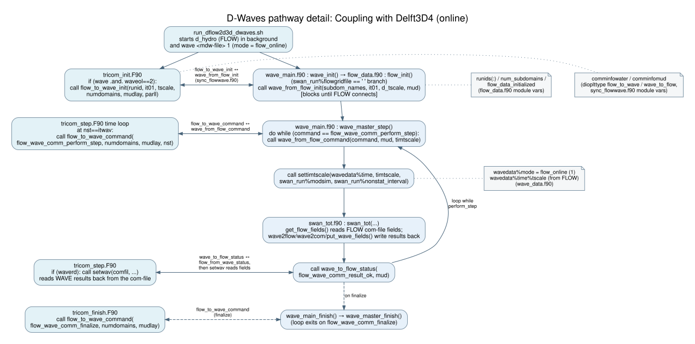

# Delft3D4-D-Waves communication model

**Delft3D4 owns the time loop. DelftIO carries commands/status;
Delft3D4 NEFIS com-files carry fields.** 
Delft3D4 and D-Waves are separately
launched processes, usually done by a shell/batch script.

[DOT source](../include/dwaves_pathway_delft3d4_detailed.dot)

## Participants and channels

| Channel | Sender/writer | Receiver/reader | Contents |
|---|---|---|---|
| DelftIO | Delft3D4 | D-Waves | Initialization metadata, step/time and finalize commands. |
| DelftIO | D-Waves | Delft3D4 | Calculation completion/status. |
| Delft3D4 NEFIS com-files | Delft3D4 | D-Waves | Selected hydrodynamic fields on Delft3D4 grids. |
| Same com-files | D-Waves, with `WriteCOM` | Delft3D4 | Wave fields already mapped onto Delft3D4 grids. |
| D-Waves/SWAN staged files | D-Waves / SWAN | SWAN / D-Waves | Solver inputs, nesting boundaries and results; internal to D-Waves execution. |

`WaveOL` keyword in the .mdf file configures Delft3D4's online behavior; it does not launch D-Waves.
The launcher starts both processes. Mode 1 and a blank D-Flow FM
`[Output] COMFile` select the classic D-Waves handshake.

**Com-file format.** The com-file that Delft3D4 and D-Waves exchange is always a
NEFIS file pair (`com-<runid>.dat` and `.def`). Delft3D4 can write its map,
Fourier, history and drogue files as NetCDF (keyword `FLNcdf`), but not the
com-file: Delft3D4 stops with an error if `com` or `all` is listed as a NetCDF output
([rdprfl.f90](../../../flow2d3d/packages/flow2d3d_io/src/input/rdprfl.f90#L162)).

Delft3D4 and D-Waves use the same NEFIS library and file layout, but each has
its own code for reading and writing it:

- **Delft3D4** goes through its generic I/O layer, where the com-file is
  described as data groups and elements, for example group `BOTTIM`
  ([rwbotc.f90](../../../flow2d3d/packages/flow2d3d_io/src/output/rwbotc.f90#L87))
  and the wave fields it reads back
  ([setwav.f90](../../../flow2d3d/packages/flow2d3d_io/src/output/setwav.f90#L187)).
- **D-Waves** does not use that layer. It reads and writes the com-file with
  small wrappers (`putgti`, `putgtr`, `putgtc`, `putgtl`) that call the NEFIS
  routines directly (`crenef`, `getelt`, `putelt`, `clsnef`; see
  [putgtr.f90](../../packages/data/src/putgtr.f90#L144)). Each call opens the
  `.dat/.def` pair, accesses one element and closes it again. The group and
  element names are hard-coded in the readers, for example `BOTTIM` / `DP` in
  [get_dep.f90](../../packages/io/src/get_dep.f90#L81), which matches what
  Delft3D4 writes.

D-Waves selects this NEFIS path when `[Output] COMFile` is blank
([put_wave_fields.f90](../../packages/io/src/put_wave_fields.f90#L18)). 

## Startup and repeated exchange

1. Delft3D4 initializes its DelftIO connection; D-Waves receives domain
   identifiers and time metadata, reads geometry and prepares maps.
2. Delft3D4 advances internal timesteps to a configured wave-coupling point.
   All participating Delft3D4 domains update their com-files before the master
   requests a D-Waves calculation.
3. D-Waves receives the step/time, reads selected Delft3D4 fields and maps them to
   each SWAN grid. It runs the grids in configured order, including nested
   computations using parent boundary output.
4. D-Waves accumulates mapped results on Delft3D4 grids and writes the com-files
   (`WriteCOM` is mandatorywhen in online mode). It then reports completion through DelftIO to Delft3D4.
5. Delft3D4's command call returns; it reads wave fields through `setwav` at
   its read point and continues its time loop. D-Waves waits for the next
   command. Delft3D4 sends finalize at the end.

The coupling interval need not equal Delft3D4's numerical timestep. The
com-files are the shared field data exchange method, not used for time synchronization.
Delft3D4 input selections gate which fields D-Waves reads; the writeback path is
always active online because `WriteCOM` is mandatory.
For this Delft3D4 pathway, D-Waves starts SWAN as a separate executable, which
uses OpenMP for parallelization. 

## Mapping and parallel execution

D-Waves prepares both mapping directions per Delft3D4/SWAN grid pair using
`make_grid_map`/`mkmap`; `grmap` applies the stored weights in each calculation.
Delft3D4 and SWAN grids may differ in resolution and extent.

On writeback, `swan_tot` calls `wave2flow` before `wave2com` and
`put_wave_fields`, only when the com-file is a Delft3D4 NEFIS file
(`[Output] COMFile` blank,
[swan_tot.f90](../../packages/manager/src/swan_tot.f90#L501)). `wave2flow`
([wave2flow.f90](../../packages/kernel/src/wave2flow.f90#L1)) rotates the
wave force vector (`fx`, `fy`) and the mass flux vector (`mx`, `my`), which
were mapped onto the Delft3D4 grid in Cartesian orientation at water level
points, into components along the grid's u- and v-directions at the u- and
v-points of the staggered curvilinear grid, using the grid angle and spacing.
It also adjusts the wave direction for the grid orientation (`dircor`). The
D-Flow FM route does not call it, because that grid is unstructured and needs
no such conversion. The same call is made when a saved Delft3D4 com-file is
used in the standalone pathway.

For partitioned Delft3D4 runs, all domain com-files must be ready; the master
partition performs the D-Waves command/status exchange while other partitions
wait. This Delft3D4 partition coordination is separate from SWAN's OpenMP
parallelism. The SWAN-grid/nest loop remains sequential since nested SWAN is not
SWAN grid partition or SWAN MPI ranks.

## Fluid-mud extension: preserve both dependencies

Mode 2 adds a **second connection to the mud model**. D-Waves waits for both
water and mud commands, reads mud density, viscosity, depth and level,
and reports completion to both. The implementation requires one water
domain and one mud domain with identical grids. This restriction concerns
the water/mud grids, not the SWAN grid.

This is a classic Delft3D4 extension, not a D-Flow FM/BMI mud capability or a
general suspended-sediment option. 

## Implementation links

| Responsibility | Entry points |
|---|---|
| Launch and Delft3D4 initialization | [launcher](../../../flow2d3d/scripts/run_dflow2d3d_dwaves.sh#L136), [trisim](../../../flow2d3d/packages/flow2d3d_manager/src/trisim.F90#L131), [tricom_init](../../../flow2d3d/packages/flow2d3d_manager/src/tricom_init.F90#L1478) |
| Delft3D4 writes, synchronization and wave reads | [tricom_step: postpr and rwbotc](../../../flow2d3d/packages/flow2d3d_manager/src/tricom_step.F90#L670), [master command / partition wait](../../../flow2d3d/packages/flow2d3d_manager/src/tricom_step.F90#L734), [setwav call](../../../flow2d3d/packages/flow2d3d_manager/src/tricom_step.F90#L826) |
| Command/status protocol | [sync_flowwave](../../../../utils_lgpl/delftio/packages/delftio/src/delftio_sync/sync_flowwave.f90#L330), [wave_master_step](../../packages/manager/src/wave_main.f90#L405) |
| Remapping and grid loop | [grids_and_gridmaps](../../packages/kernel/src/grids_and_gridmaps.f90#L165), [get_flow_fields](../../packages/io/src/get_flow_fields.f90#L102), [swan_tot](../../packages/manager/src/swan_tot.f90#L106), [wave2flow call](../../packages/manager/src/swan_tot.f90#L506) |
| Water/mud dependencies | [connection setup](../../packages/data/src/flow_data.f90#L139), [mud-field reads](../../packages/io/src/get_flow_fields.f90#L317), [SWAN mud input](../../packages/data/src/swan_input.f90#L3676) |
| Com-file format (NEFIS only) | [FLNcdf parsing](../../../flow2d3d/packages/flow2d3d_io/src/input/rdprfl.f90#L140), [com rejected](../../../flow2d3d/packages/flow2d3d_io/src/input/rdprfl.f90#L162), [D-Waves NEFIS writeback branch](../../packages/io/src/put_wave_fields.f90#L18), [D-Waves NetCDF reader (D-Flow FM layout)](../../packages/io/src/get_var_netcdf.f90#L128) |
| D-Waves MPI coordination | [master/worker dispatch](../../packages/manager/src/wave_main.f90#L385), [run_swan](../../packages/kernel/src/run_swan.f90#L90), [worker barrier](../../packages/kernel/src/run_swan_slave.f90#L60) |

Configuration reference: [D-Waves User Manual](../include/D-Waves_User_Manual.pdf),
Appendix A.1.1 (`FlowFile` and `FlowMudFile`).
