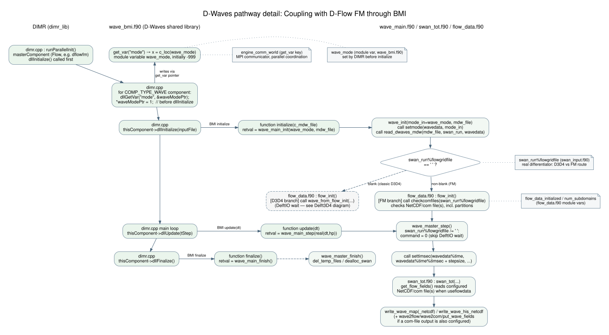

# D-Waves pathway with D-Flow FM through DIMR/BMI

This page describes live D-Flow FM / WAVE orchestration through DIMR and the
WAVE BMI library. The component lifecycle and timestep scheduling are
controlled through BMI; gridded FM fields are exchanged through a NetCDF
communication file, not through generic WAVE BMI field variables.

## Detailed diagram

Graphviz source: [DOT](../include/dwaves_pathway_fm_bmi_detailed.dot).

## DIMR and WAVE BMI lifecycle

The WAVE shared library exposes BMI `initialize`, `update` and `finalize`
wrappers that delegate to `wave_main_init`, `wave_main_step(dt)` and
`wave_main_finish`. DIMR initializes the designated master component first
(normally D-Flow FM), sets the WAVE BMI `mode` to `flow_online = 1`, then
initializes WAVE. DIMR subsequently schedules component updates and invokes
WAVE's BMI `update(dt)` when WAVE is due.

The WAVE BMI wrapper exposes `mode` and `engine_comm_world` through
`get_var`, and accepts the `mode` key through `set_var`. It does not expose
the SWAN grid or FM forcing fields as generic BMI variables. Nor is there a
separate numeric FM mode: both FM/BMI and classic Delft3D4 online WAVE use
mode 1; the configured file route selects the data path.

For the FM NetCDF route, MDW `[Output] COMFile` sets
`swan_run%flowgridfile`. In non-standalone mode, WAVE advances its time by
the `dt` supplied through BMI and performs one SWAN calculation per
externally scheduled update. Initialization forces `nttide = 1` on this
route so standalone MDW calculation-time lists do not cause multiple SWAN
calculations inside one update. This is a number of calculation times, not a
number of SWAN grids.

The `[Output] COMFile` path is also available in standalone mode for reading
saved FM output; in that case standalone scheduling applies. See the
[standalone pathway](./D-Waves_pathway_standalone.md) for its file-backed
and timing behavior.

## FM communication-file lifecycle

D-Flow FM writes a dedicated NetCDF communication file, usually named
`*_com.nc`, directly from model state. This is not a conversion of ordinary
FM map output to a classic Delft3D4 com-file.

During DIMR initialization, the FM master component initializes first. Its
initial external-output path calls `wricom` and creates/writes the
communication file, including grid geometry and initial fields. DIMR then
initializes WAVE. WAVE reads MDW configuration, checks the configured
communication file(s) through `flow_init`, reads the FM and SWAN grids, and
prepares spatial mappings before the first BMI update. It reads grid
geometry from the file; it does not request the FM grid through a BMI
`get_var` call.

At calculation time, when `swan_run%useflowdata` is true, WAVE's
`get_flow_fields` reads requested variables directly from the NetCDF
communication file, including fields such as bed elevation, water level and
velocity. It then maps those fields onto the SWAN computational grid.
`[Output] COMFile` selects the file route, whereas FLOW input selections
determine which fields WAVE reads.

FM updates the communication file from its external-output path at its
configured output instants. DIMR's WAVE component schedule should be
coordinated with this cadence so the required FM fields are available for
each WAVE update. DIMR controls when components advance; the NetCDF file
carries gridded fields between them.

## Spatial mapping and optional writeback

The FM-to-SWAN and SWAN-to-FM mapping paths are prepared separately for each
configured FM-partition/SWAN-grid pair during WAVE initialization:

| Direction | Setup and runtime behavior |
|---|---|
| FM → SWAN | WAVE generates/loads ESMF regridding weights for each pair. At runtime `get_flow_fields` reads the current FM values and `grmap_esmf` applies the stored sparse weights. |
| SWAN → FM | If `[Output] WriteCOM` is enabled, WAVE builds an internal map with `mkmap`; `map_swan_output` applies it with `grmap` before `put_wave_fields` writes results to the NetCDF communication file. |

The FM-to-SWAN mapping uses ESMF; the reverse SWAN-to-FM mapping does not.
Weights are prepared once per grid pair per WAVE initialization and reused
while grid geometry remains unchanged; they are not recomputed each timestep.
With read-only FM input, only the FM-to-SWAN map is needed. The presence of
an FM file does not make the exchange bidirectional.

Flow input and FLOW-grid output are independent. `[Output] WriteCOM` can
require FM communication-file and grid initialization even when
`useflowdata` is false. For FM writeback, WAVE uses `wave2com` and
`put_wave_fields`; the legacy `wave2flow` vector conversion is not used on
this route. Writing WAVE results does not create a FLOW simulation or
produce a complete set of FM results.

## Mode-2 limitation

Mode 2 (`flow_mud_online`) is implemented as a classic Delft3D4 fluid-mud
extension and is not an FM/BMI coupling option. Although MDW parsing can
assign mode 2 when `FlowFile` and `FlowMudFile` are nonblank, the FM NetCDF
branch does not initialize the mud connection or `mudids` needed for mud
field acquisition. The BMI wrapper also does not implement the mode-2
time-query operations. See the [Delft3D4 pathway](./D-Waves_pathway_delft3d4.md)
for the supported classic fluid-mud pathway.

## Implementation references

- [WAVE BMI lifecycle and variables](../../packages/wave/src/wave_bmi.f90#L63)
- [WAVE shared-library target](../../packages/wave/wave_dll.cmake)
- [DIMR component initialization and scheduling](../../../dimr/packages/dimr_lib/src/dimr.cpp#L429)
- [WAVE initialization order and `nttide` adjustment](../../packages/manager/src/wave_main.f90#L179)
- [FM communication-file route](../../packages/data/src/flow_data.f90#L68)
- [FM and SWAN grid initialization](../../packages/kernel/src/grids_and_gridmaps.f90#L82)
- [FM NetCDF grid reader](../../packages/kernel/src/grids_and_gridmaps.f90#L142)
- [FM field acquisition and mapping](../../packages/io/src/get_flow_fields.f90#L102)
- [FM NetCDF variable reader](../../packages/io/src/get_var_netcdf.f90#L123)
- [FM BMI initialization](../../../dflowfm/packages/dflowfm_lib/src/unstruc_bmi.F90#L233)
- [FM initial external output](../../../dflowfm/packages/dflowfm_kernel/src/dflowfm_manager/unstruc_api.F90#L263)
- [FM communication-file output](../../../dflowfm/packages/dflowfm_kernel/src/dflowfm_manager/flow_externaloutput.F90#L216)
- [FM `wricom` writer](../../../dflowfm/packages/dflowfm_kernel/src/dflowfm_io/wricom.f90#L44)
- [WAVE-to-FM mapping and writeback](../../packages/manager/src/swan_tot.f90#L412)
- [Map construction and ESMF weights](../../packages/data/src/swan_flow_grid_maps.f90#L361)
- [BMI time advancement](../../packages/wave/src/wave_bmi.f90#L130)
