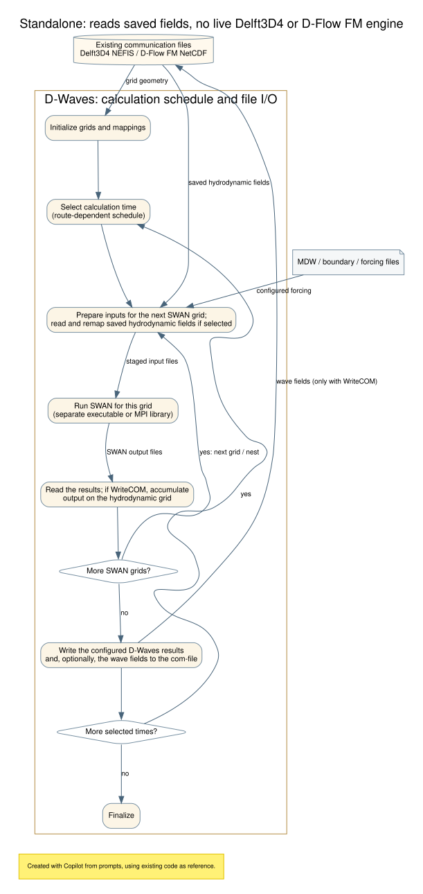

# D-Waves standalone pathway

This page traces standalone WAVE execution, including optional use of saved
FLOW results. It distinguishes the classic Delft3D4 file route from the
FM NetCDF file route; standalone execution does not imply that a FLOW model
is running.

## Detailed diagram

Graphviz source: [DOT](../include/dwaves_pathway_standalone_detailed.dot).

## Mode, configuration and route selection

The standalone executable defaults to `stand_alone = 0` and calls
`wave_main_init`, `wave_main_step(-1)` and `wave_main_finish`. MDW parsing can
change the mode: a nonblank `[General] FlowFile` selects `flow_online = 1`,
and a nonblank `[General] FlowMudFile` in that branch selects mode 2.
Consequently, launching the executable directly does not by itself guarantee
standalone scheduling.

Mode and data route are separate selectors:

| MDW setting / internal state | Effect |
|---|---|
| `[General] ComFile` | Selects legacy Delft3D4 NEFIS com-file runids for saved FLOW input. |
| `[Output] COMFile` | Sets `swan_run%flowgridfile` and selects the FM NetCDF communication-file route. It is not an MDW `FlowGridFile` keyword. |
| FLOW input selections | Derive `swan_run%useflowdata`; this determines whether WAVE reads FLOW fields. |
| `[Output] WriteCOM` | Sets `swan_run%swwav` and enables writing selected WAVE results to the configured FLOW communication file(s). |

The presence of `[Output] COMFile` alone does not make a run online or imply
that FLOW is advancing. In standalone mode it can identify saved FM output.
Likewise, `useflowdata` is internal state, not an MDW keyword.

## Independent calculation or offline FLOW input

Standalone describes how WAVE runs, not where all its inputs originate.
An independent calculation can use WAVE-configured bathymetry, water level,
currents, wind and wave boundary inputs without FLOW results. Alternatively,
selected fields from a prior FLOW run can provide hydrodynamic conditions
without a live FLOW process.

`wave_init` calls `flow_init` when FLOW input or `WriteCOM` requires
communication-file/grid setup. `flow_init` identifies the source files or
domains; it does not read and map every field. During calculation,
`swan_tot` calls `get_flow_fields` only when `swan_run%useflowdata` is true.
The selected fields are read from the configured communication files and
mapped onto the SWAN grids. Standalone WAVE neither launches nor advances
Delft3D4 FLOW or D-Flow FM.

The saved-file options differ by engine:

| Saved data | Configuration and behavior |
|---|---|
| Delft3D4 FLOW | Use mode 0, leave `[General] FlowFile` blank, and select the runid(s) with `[General] ComFile` (or the default WAVE runid). No DelftIO handshake is performed. Legacy offline workflows should align WAVE calculation times with stored FLOW output times. |
| D-Flow FM | Set `[Output] COMFile` to the FM NetCDF communication file. WAVE checks the file and any partition variants, reads its grid and fields, and does not run the FM model. The file must contain the grid and selected fields; an arbitrary FM map-output file is not a substitute. |

The MDW time schedule and file route both affect when calculations occur:

- With blank `swan_run%flowgridfile`, `wave_master_step` calls
  `swan_tot(..., selectedtime=0)`. `swan_tot` processes the MDW `timwav`
  schedule itself.
- With nonblank `swan_run%flowgridfile`, standalone scheduling uses the
  supplied `stepsize` to select MDW times in the step interval. If no explicit
  times are present, a separate single-computation branch applies.

The executable's `stepsize = -1` is therefore not a universal “run the whole
simulation” value: it is unused by the legacy standalone branch, while the
FM-file branch uses the interval logic. Do not confuse `[General] FlowFile`
(mode selection) with `[Output] COMFile` (FM communication-file route).

## Grids, forcing and field mapping

`n_swan_grids` counts configured SWAN computational grids, generally the
MDW `[Domain]` entries. `n_flow_grids` separately counts FLOW grids or
partitions used for input and/or WAVE output. Neither count is the MPI rank
count. Independent standalone runs can have no FLOW grids; FLOW-grid setup
is still needed when `WriteCOM` is enabled even if no FLOW fields are read.

FLOW and SWAN grids do not need identical dimensions, extents or resolution.
During initialization, `grids_and_gridmaps` creates maps for each
FLOW-grid/SWAN-grid pair. Forcing fields are read on their source FLOW grid
and mapped to the SWAN grid. Their physical coordinates must be compatible,
and the FLOW domains must cover the SWAN area where FLOW forcing is needed.
The mode-2 identical-grid condition concerns the Delft3D4 water and mud
grids, not the FLOW and SWAN grids.

The mapping implementations differ by route:

- **Legacy Delft3D4 files:** `mkmap` prepares interpolation references and
  weights; `grmap` applies them during calculation.
- **FM NetCDF files:** WAVE prepares ESMF regridding weights for
  FLOW-to-SWAN mapping and applies them with `grmap_esmf`. If `WriteCOM` is
  also enabled, WAVE separately prepares an internal SWAN-to-FLOW map and
  applies it for writeback.

Weights are prepared once per grid pair during WAVE initialization and reused
for field values at calculation time. The temporary provider/receiver grid
filename propagation in `grids_and_gridmaps` reuses serialized grid files;
it is not where the overlap search or regridding weights are computed.

External meteo forcing is another optional input source. `wave_init`
registers the configured meteo sources and SWAN target grid. At calculation
times `swan_tot` updates the meteo data and retrieves wind components (and
ice fields when configured); these are staged for SWAN. External meteo wind
takes precedence over FLOW wind when both are configured. The commented-out
pressure retrieval in `swan_tot` is not an active pressure input path.

## SWAN execution and optional WAVE output

`swan_tot` is a WAVE manager routine, not the SWAN executable. It prepares
inputs for each SWAN grid, writes the SWAN input file, calls `run_swan`,
reads the results and handles mapping/writeback. `[General] SwanMode=exe`
(the default) launches the SWAN program; `SwanMode=lib` invokes `swan_lib`
inside the WAVE process and is restricted to MPI runs. The WAVE-SWAN file
staging interface is used in either mode and is not the outer FLOW-WAVE
control protocol.

With `[Output] WriteCOM` enabled, standalone WAVE can map selected SWAN
results onto the configured FLOW grid(s) and write them into the existing
communication file(s). This does not start FLOW or create a FLOW simulation.
The legacy route uses `wave2flow` for vector conversion before
`wave2com`/`put_wave_fields`; the FM route skips the legacy `wave2flow`
conversion and writes through `wave2com`/`put_wave_fields`. This is
communication-file writeback, not ordinary WAVE map output.

## Implementation references

- [WAVE executable entry point](../../packages/wave/src/wave_exe.f90#L82)
- [Initialization, mode and standalone scheduling](../../packages/manager/src/wave_main.f90#L180)
- [MDW route and input selection](../../packages/data/src/swan_input.f90#L915)
- [FLOW file/domain initialization](../../packages/data/src/flow_data.f90#L79)
- [Grid and mapping initialization](../../packages/kernel/src/grids_and_gridmaps.f90#L82)
- [FLOW field reads and mapping](../../packages/io/src/get_flow_fields.f90#L102)
- [Per-grid SWAN orchestration and writeback](../../packages/manager/src/swan_tot.f90#L138)
- [Meteo initialization and cleanup](../../packages/manager/src/wave_main.f90#L255)
- [SWAN executable/library selection](../../packages/kernel/src/run_swan.f90#L65)
