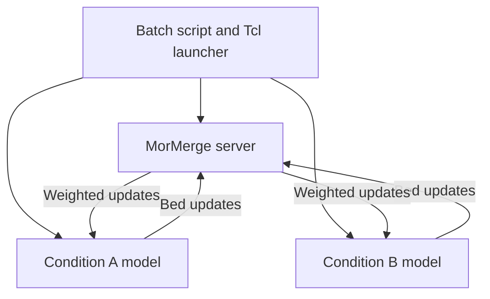

# MorMerge user manual

This manual describes `mormerge.tcl` version `2.31`, with general operation, Linux Slurm setup, and local Windows setup for D-Flow FM through DIMR and Delft3D 4 through `d_hydro`. Each engine section includes one-node and multi-node Slurm runs with and without online WAVE, other component and coupling configurations, and Windows setup and run instructions.

1. [General functioning](#1-general-functioning)
2. [Setting up a DIMR run](#2-setting-up-a-dimr-run)
3. [Setting up a d_hydro run](#3-setting-up-a-d_hydro-run)

Windows instructions are available for the common runtime setup and each engine.

- [Windows runtime setup](#19-windows-runtime-setup)
- [Windows DIMR run](#29-windows-dimr-run)
- [Windows d_hydro run](#38-windows-d_hydro-run)

## 1. General functioning

### 1.1. Conditions and morphological merging

A MorMerge calculation runs several conditions of the same morphological model concurrently. Conditions can differ in wave forcing, wind, discharge, or other boundary conditions. At morphological exchange times, each FLOW condition sends its sediment-specific and cell-specific bed updates to a MorMerge server. The server combines them using the condition weights and returns the combined updates to the conditions.

The weights in `condition:weight` are normalized by their total. Supply numeric weights with a nonzero total. For example, weights `3.0` and `1.0` give contributions of `0.75` and `0.25`. All active conditions participate in the exchange, so they need enough resources to progress concurrently throughout the calculation.

Use corresponding grids, cell ordering, initial bed levels, sediment fractions, and compatible morphological start and exchange times in every condition. MPI runs also need corresponding partitions and rank ordering across conditions. Set the morphology file's `[Morphology]` option `Multi = true`. Match simulation periods so each condition can participate until the others finish. The bundled Delft3D 4 example explains the exchange algorithm and input requirements. [MorMerge example](../../../../examples/delft3d4/05_mormerge/README)



DIMR runs use a server with run ID `singledomain`. The MPI-enabled D-Flow FM implementation gathers and distributes the morphological arrays within each condition. Direct Delft3D 4 runs use a server for each MDF run ID, including the run IDs found in a domain-decomposition file.

### 1.2. Case directory and runtime requirements

Place the calculation on a filesystem accessible from the submission host and all allocated nodes. A typical case has the following structure before submission.

```text
case/
    input/
        shared model and configuration files
        condition01/
            files that override the shared input for condition01
        condition02/
            files that override the shared input for condition02
    merge/
        model.mm
```

Each condition name in the `.mm` file must match its input subdirectory when it has overrides. Supply at least two unique conditions. MorMerge recreates `case/<condition>/`, copies the shared files there, applies the overrides, and writes a `streamfile` reference. Keep a separate case directory for every concurrent MorMerge calculation.

Use a matching installation of `mormerge`, the selected FLOW engine, and its runtime libraries. Linux Slurm runs use Bash, `/usr/bin/tclsh`, `sbatch`, `srun`, `scontrol`, and `squeue`. Windows runs use the Tcl runtime and batch files described in Section 1.9. DIMR MPI runs need an MPI-enabled build and a compatible launcher. Wave coupling also needs D-Waves, the selected SWAN implementation, and any grid-mapping tools used by that model.

Use paths without whitespace or shell metacharacters because several generated commands interpolate paths directly. The examples use `/opt/delft3d/lnx64/bin` for the installation and `queue = normal`. Replace these with the installation directory and partition for the site.

### 1.3. Select the launch path

| Calculation | Executable settings | Work launched per condition under Slurm |
| --- | --- | --- |
| D-Flow FM through DIMR | `dimrexedir`, `dimrargs` | One DIMR Slurm step containing the configured components |
| Delft3D 4 FLOW | `flowexedir`, `flowexename = d_hydro`, `flowargs` | One single-task FLOW step |
| Delft3D 4 FLOW with online WAVE | FLOW settings plus `waveexedir`, `waveargs`, `swanbatdir` | One FLOW step and one WAVE step |
| Custom orchestration | `runscript`, `runscriptargs` | One script that owns its model launch commands |

Choose one executable-setting group for the calculation and set `mormergeexedir` explicitly. A configured `dimrexedir` selects direct DIMR ahead of the other executable settings. Custom-script configurations use `runscript` and `runscriptargs` as their launch settings. DIMR handles component coupling in its XML configuration. The direct Delft3D 4 path detects online WAVE from the shared MDF files. Sections 2 and 3 describe the model-specific preparation.

### 1.4. Slurm settings

| Setting | Meaning and default |
| --- | --- |
| `queueSystem` | The script default is `slurm`, as used by the examples in this manual. |
| `queue` | Site partition used by the generated batch job. The script default is `16vcpu`. Set the site's partition explicitly. |
| `timeLimit` | Allocation wall-clock limit. The script default is `01:00:00`. |
| `nodes` | Total allocation nodes. The default is `1`. |
| `slurmControlNodes` | Node-equivalent capacity deducted when calculating packing. The default is `0`. |
| `slurmNodesPerCondition` | Nodes requested by one DIMR condition. `0` selects `1`. |
| `slurmTasksPerNode` | Tasks per node for one DIMR condition. The default is `1`. |
| `slurmConditionsPerNode` | Concurrent condition slices per allocation node. `0` derives the packing factor. |
| `slurmCpusPerTask` | CPUs reserved for each task and its `OMP_NUM_THREADS` value. The default is `1`. |
| `slurmMPI` | Direct DIMR `srun --mpi` selection. Unset or `none` leaves the command-line MPI option unset. Multi-rank DIMR requires a compatible plugin. |
| `slurmModuleCommand` | Optional shell command inserted into the generated batch script. `none` omits it. |
| `debug` | The default is `0`. `1` retains generated scripts and prints debug information. |
| `workdir` | The examples leave this unset so model processes use the case root and shared condition directories. |

Numeric geometry settings must be integers. `nodes`, `slurmTasksPerNode`, and `slurmCpusPerTask` must be at least `1`. The other three numeric Slurm geometry settings allow `0`. `slurmControlNodes` must be smaller than `nodes`. It changes the capacity calculation, while Slurm can place model ranks on any allocation node, including the batch node.

The `.mm` reader preserves embedded `=` characters, allowing shell assignments such as `slurmModuleCommand = export SLURM_MPI_TYPE=none`. Use the site's compiler and MPI module commands when required by the installed binaries.

### 1.5. Calculate allocation resources

For DIMR, let `C` be the number of conditions, `N` the nodes per condition, `T` the tasks per node per condition, `H` the CPUs per task, and `A = nodes - slurmControlNodes`. With automatic packing, the launcher derives `P = ceiling(C * N / A)`.

| Quantity | DIMR | Direct d_hydro without WAVE | Direct d_hydro with online WAVE |
| --- | --- | --- | --- |
| Tasks per condition | `N * T` | `1` | `2`, split between FLOW and WAVE |
| Allocation tasks per node | `P * T` | `P` | `2 * P` |
| Allocation CPUs per node | `P * T * H` | `P * H` | `2 * P * H` |

For the direct `d_hydro` examples, set `N = 1` and `T = 1`. With online WAVE, the geometry calculation uses these values for its separate single-task steps. For all layouts, the available condition slices must satisfy `A * P >= C * N`. Slurm allocates the actual CPUs, and each node also needs sufficient memory for the concurrent models.

The generated batch script requests the total nodes, allocation tasks per node, CPUs per task, partition, and time limit. Each DIMR step uses `--exclusive --exact` and its own task geometry so several conditions can share an allocation node while using separate CPU sets. The standalone steps use `--exact` with one node and one task. Slurm documents these job-step resource options. [Slurm srun reference](https://slurm.schedmd.com/srun.html#OPT_exact)

### 1.6. Submit and follow the calculation

Save the selected `.mm` configuration as `merge/model.mm`. From that directory, run the installed wrapper.

```bash
cd /shared/case/merge
/opt/delft3d/lnx64/bin/run_mormerge.sh model.mm
```

The equivalent direct Tcl invocation specifies both the configuration and the Tcl script.

```bash
/usr/bin/tclsh /opt/delft3d/lnx64/bin/mormerge.tcl \
    -i model.mm -s /opt/delft3d/lnx64/bin/mormerge.tcl
```

With the internal `-n` argument omitted, the launcher submits one batch job and re-enters Tcl inside that allocation. Submission success prints the job ID and `Finished normally`. The calculation then continues in the batch job. The batch script runs any `slurmModuleCommand`, and MorMerge checks the MPI environment before cloning inputs and starting servers for direct multi-rank DIMR.

Inside the allocation, MorMerge creates the condition directories, clears initialization markers, starts the servers, starts all conditions, and waits for completion. A rejected `sbatch` submission returns an error immediately. A later failed `squeue` listing produces a warning after successful submission. Slurm returns from `sbatch` when the controller accepts the script, while scheduling and execution continue separately. [Slurm sbatch reference](https://slurm.schedmd.com/sbatch.html)

#### 1.6.1. Use an existing allocation

Within a batch allocation whose geometry matches the selected example, run the wrapper once and supply its existing node count.

```bash
cd /shared/case/merge
/opt/delft3d/lnx64/bin/run_mormerge.sh model.mm \
    --NNODES "$SLURM_JOB_NUM_NODES"
```

The wrapper passes `--NNODES` to Tcl as `-n`, overriding the `.mm` allocation-node count and selecting execution within the allocation. Submit the batch job from the case root or `merge/` because the launcher uses `SLURM_SUBMIT_DIR` to locate the case. Supply allocation tasks per node and CPUs per task using the resource calculation above.

Load modules and export runtime settings in the existing batch script. `slurmModuleCommand` takes effect in MorMerge-generated batch scripts. The wrapper's `--NNODES` option describes the whole existing allocation. A `dimrargs --NNODES` value describes one condition.

Sites requiring an account, QoS, or memory request can use their supported `SBATCH_*` submission settings or supply an existing allocation with those options. [Slurm submission environment](https://slurm.schedmd.com/sbatch.html#SECTION_INPUT-ENVIRONMENT-VARIABLES)

#### 1.6.2. Local execution

For a local Linux run on one host, `nodes = local` selects the local launch path. DIMR then uses `run_dimr.sh`, and Delft3D 4 starts the FLOW and optional WAVE executables directly. Prepare the engine inputs in the same way as for Slurm, with enough local resources for concurrent conditions. Set the intended OpenMP and SWAN thread environment before launch. The automatic thread settings and Slurm validation below take effect in the Slurm path. Local DIMR arguments follow the installed `run_dimr.sh` interface.

### 1.7. OpenMP and SWAN threads

Generated Slurm batch and condition scripts set `OMP_NUM_THREADS` to `slurmCpusPerTask`. For direct DIMR or separate online WAVE, `OMP_NUM_THREADS_SWAN` defaults to `1` when unset or empty. An existing override is preserved and must be a single positive integer no greater than `slurmCpusPerTask`. Validation occurs before the servers and model processes start.

For a generated job, place an override in its module command when needed.

```text
slurmCpusPerTask   = 2
slurmModuleCommand = export OMP_NUM_THREADS_SWAN=2
```

An existing batch script can export `OMP_NUM_THREADS_SWAN` before running the wrapper. Combine required site commands into the same `slurmModuleCommand` value. The standalone WAVE examples in Section 3 include `SLURM_MPI_TYPE=none`. The SWAN executable wrapper uses `OMP_NUM_THREADS_SWAN` to set SWAN threads.

The WAVE examples in this manual use `[General] SwanMode = exe`, which is the MDW default. `SwanMode = lib` requires the wave component to have a valid MPI communicator and an MPI-enabled execution setup. It bypasses the executable wrapper and its SWAN thread override. The wave input reader checks this requirement. [SWAN mode selection](../../../engines_gpl/wave/packages/data/src/swan_input.f90)

### 1.8. Completion, logs, and diagnosis

| Path relative to the case root | What to inspect |
| --- | --- |
| `merge/d3d-mormerge_qsubgo.sh` | Allocation request, module command, and Tcl invocation |
| `merge/d3d-mormerge_qsubwait.sh` | Submission command |
| `merge/d3d-mormerge-<jobid>.out` and `.err` | Batch output and final calculation status |
| `merge/d3d-flow_run<condition>.sh` | Executables, arguments, Slurm steps, and thread settings |
| `<condition>/dimr.scr` | DIMR and component initialization and progress |
| `<condition>/d_hydro.scr` and `<condition>/wave.scr` | Separate Delft3D 4 model output |
| `<condition>/runscript.scr` | Custom launch script output |
| `merge/mormerge_<runid>.scr` and `.log` | Server output and input details |
| `merge/sync/merge<runid>` and `merge/sync/<condition>flow<runid>` | Initialization markers |

Each Slurm condition launcher records its child PIDs and collects every exit status. Tcl reports `mormerge.tcl : Failed` and exits nonzero after observed child failures. The wrapper propagates that status. Peers may remain waiting after a failed condition, so inspect both the first model error and the remaining steps if the job stays running. Marker waits have a retry limit and continue with a message when it is reached.

A server can exit with status `1` when successful conditions close their streams. In Slurm runs, Tcl accepts the following exact diagnostic pattern as expected shutdown when the condition launchers finish successfully.

```text
GetPutArrayError: ABORT Recv from <peer> returns 0 bytes. Is the peer process dead?
```

Other receive errors and failed conditions produce a Slurm failure status once the children exit. A printed start message or initialization marker alone establishes only that initialization reached that stage. Section 1.9 describes the Windows status limitation.

| Symptom | First check |
| --- | --- |
| `DIMR MPI environment preflight failed` | Plugin, MPI build, module environment, and generated rank counts |
| WAVE says it is running in parallel without DIMR | Standalone MPI environment setting in Section 3 |
| WAVE waits for FLOW initialization | First error in the matching `d_hydro.scr` and the FLOW step state |
| `srun` cannot confirm the allocation | Controller communication and individual step states, even if the job is running |
| Calculation waits after a condition exits | Remaining model processes, their logs, and morphological exchange timing |

For a first cluster test, use `debug = 1`, inspect the generated geometry, confirm the reported engine rank counts and thread counts, and verify model output through the intended stop time. Working multi-node DIMR and standalone Delft3D 4 FLOW/WAVE runs have been reported for the installation used to prepare these examples. The eight main Slurm layout recipes were checked against the Tcl configuration reader and generated launch commands. Each additional model and coupling combination needs verification against its expected outputs.

### 1.9. Windows runtime setup

The Windows recipes run concurrent conditions on one PC. They use `nodes = local` and the Windows launch path. The multi-node Slurm configurations earlier in this manual apply to Linux allocations.

Use a complete 64-bit Windows installation of the relevant suite, preserving its `bin/` and `share/` directories and supplied runtime DLLs. A build containing D-Flow FM provides the DIMR model libraries. A Delft3D 4 build provides `d_hydro.exe` and `flow2d3d.dll`. Use the intended revision of `mormerge.tcl` in the installation.

| Purpose | Files expected in the installation's `bin/` directory |
| --- | --- |
| MorMerge launcher | `run_mormerge.bat`, `mormerge.tcl`, `tclkitsh852.exe`, `mormerge.exe` |
| DIMR with D-Flow FM | `run_dimr.bat`, `dimr.exe`, `dimr.dll`, `dflowfm.dll` |
| Direct Delft3D 4 | `d_hydro.exe`, `flow2d3d.dll` |
| Online WAVE | `wave.dll` for DIMR or `wave.exe` for the direct path, plus `swan.bat` and `swan_omp.exe` |

Models using ESMF grid mapping also need the bundled ESMF executable and batch wrapper. Keep the library and data files supplied with the installation available to its wrappers.

Use PowerShell for the commands below. Set `$bin` to the installation selected in the engine-specific section and verify the bundled Tcl runtime.

```powershell
$bin = 'D:\Delft3D\fm-suite\bin'
'puts [info patchlevel]' | & "$bin\tclkitsh852.exe"
```

The bundled runtime tested here reports `8.5.2`. Tcl `8.6.16` was also used for Windows batch-generation checks. The engine tests use the supplied batch wrapper and Tcl `8.5.2`.

Set the OpenMP environment before launch. The Windows local path inherits these settings, while the automatic Slurm thread defaults and checks execute in the Slurm path.

```powershell
$env:OMP_NUM_THREADS = '1'
$env:OMP_NUM_THREADS_SWAN = '1'
```

Keep each case in its own writable directory and launch from its `merge/` subdirectory. Save a local `.mm` file using the engine-specific examples below. Both conditions and all their model processes need sufficient CPU and memory capacity on the PC.

The installed `run_mormerge.bat` selects `bin/mormerge.tcl`. To test a workspace revision directly, select that Tcl file explicitly with the installed runtime.

```powershell
$script = 'D:\OSS\Delft3d_trunk\src\tools_gpl\mormerge\scripts\mormerge.tcl'
Set-Location 'D:\cases\mormerge_case\merge'
& "$bin\tclkitsh852.exe" $script -i model_windows.mm -s $script
```

The Windows batch path starts several processes with `start /b`. An engine can fail while Tcl still prints `mormerge.tcl : Finished`; this was observed during a Windows test with invalid FLOW input. Check every engine's diagnostic log and output through the stop time before accepting a run as successful.

A modern-Windows identification warning from `setPlatform` can appear with newer Tcl runtimes because that routine recognizes XP and Vista explicitly.

## 2. Setting up a DIMR run

### 2.1. Prepare the model and choose the component configuration

Use a complete morphological D-Flow FM case. Its morphology file needs `[Morphology] Multi = true`, with the same grid, initial bed, sediment definitions, and partition ordering across conditions. The examples use conditions `175` and `355`, `fm/test.mdu`, and optional `wave/t05.mdw`, following the coupled trench TestBench case. Replace those names to match another case. [Coupled MorMerge TestBench configuration](../../../../test/deltares_testbench/configs/dimr/dimr_dflowfm_dwave_mormerge_lnx64.xml)

The shared input has `input/fm/` for FLOW files and, for a coupled run, `input/wave/` for shared wave files. Put condition-specific overrides in `input/175/` and `input/355/`, retaining the model's subdirectory structure. For example, wave boundary directions can be set in `input/175/wave/t05.mdw` and `input/355/wave/t05.mdw`.

Set `dimrexedir` in `.mm` to select DIMR and set `mormergeexedir` to its installation directory. The Slurm launcher executes `<dimrexedir>/dimr` directly. The model's XML selects the engine libraries, component working directories, and coupling schedule.

The main examples use two FLOW ranks per condition. Generate the two partitions after applying the model settings for the selected coupling mode. The repository's parallel example uses the following partitioning interface. [Partitioning example](../../../../examples/dflowfm/09_dflowfm_parallel_dwaves/run.sh)

```bash
cd /shared/case/input/fm
/opt/delft3d/lnx64/bin/run_dflowfm.sh \
    --partition:ndomains=2:icgsolver=6 test.mdu
```

Confirm that both partition MDUs and their referenced meshes exist, with the same partitioning for every condition. In the trench case these are `test_0000.mdu`, `test_0001.mdu`, `t01_0000_net.nc`, and `t01_0001_net.nc`. DIMR's component input remains `test.mdu`, and the engine selects the partition files for its ranks.

For condition-specific MDU settings, supply corresponding partition MDUs in each condition's overrides or generate them from that condition's updated source MDU while retaining identical mesh partitions and rank ordering. During the MPI run, the engine reads those partition MDUs. A shared boundary file can instead be overridden through the filename referenced by the partition MDUs. The wave-direction overrides described above change the MDW files.

### 2.2. One node without online coupling

Set the unpartitioned model's `[waves] Wavemodelnr = 0` before partitioning. Save the following as `input/dimr_flow.xml`. This example assigns the FLOW component both ranks.

```xml
<?xml version="1.0" encoding="UTF-8"?>
<dimrConfig xmlns="http://schemas.deltares.nl/dimr">
    <documentation>
        <fileVersion>1.3</fileVersion>
    </documentation>
    <control>
        <start name="DFlowFM"/>
    </control>
    <component name="DFlowFM">
        <library>dflowfm</library>
        <process>0 1</process>
        <mpiCommunicator>DFM_COMM_DFMWORLD</mpiCommunicator>
        <workingDir>fm</workingDir>
        <inputFile>test.mdu</inputFile>
    </component>
</dimrConfig>
```

Save the following complete configuration as `merge/model.mm`. Replace `pmi2` with the site's compatible Slurm MPI plugin and supply any required runtime module command.

```text
dimrexedir             = /opt/delft3d/lnx64/bin
dimrargs               = -c 2 --NNODES 1 dimr_flow.xml
mormergeexedir         = /opt/delft3d/lnx64/bin
queueSystem            = slurm
queue                  = normal
timeLimit              = 00:30:00
nodes                  = 1
slurmControlNodes      = 0
slurmNodesPerCondition = 1
slurmTasksPerNode      = 2
slurmConditionsPerNode = 0
slurmCpusPerTask       = 1
slurmMPI               = pmi2
debug                  = 1
condition:weight       = 175 : 1.0
condition:weight       = 355 : 1.0
```

Automatic packing gives two conditions per allocation node. Each condition starts two ranks, so the batch job requests four tasks and four CPUs on one node. Submit from `merge/`.

```bash
cd /shared/case/merge
/opt/delft3d/lnx64/bin/run_mormerge.sh model.mm
```

Each condition's `dimr.scr` should report two FLOW ranks. Verify the server connection, calculation progress, and output through the stop time.

### 2.3. One node with online WAVE

Set the source MDU's `[waves] Wavemodelnr = 3` and regenerate its partitions. Prepare the WAVE grid, bathymetry, boundary conditions, and `COMFile` path for the partitioned FLOW output. The parallel repository example illustrates these files and their relative paths. [Parallel FLOW/WAVE example](../../../../examples/dflowfm/09_dflowfm_parallel_dwaves/dimr_config.xml)

Save the following as `input/dimr_flow_wave.xml`. It uses the trench case's 120-second wave update interval. Set the interval and end time to the requirements of another model.

```xml
<?xml version="1.0" encoding="UTF-8"?>
<dimrConfig xmlns="http://schemas.deltares.nl/dimr">
    <documentation>
        <fileVersion>1.3</fileVersion>
    </documentation>
    <control>
        <parallel>
            <startGroup>
                <time>0.0 120.0 9999999.0</time>
                <start name="Wave"/>
            </startGroup>
            <start name="DFlowFM"/>
        </parallel>
    </control>
    <component name="DFlowFM">
        <library>dflowfm</library>
        <process>0 1</process>
        <mpiCommunicator>DFM_COMM_DFMWORLD</mpiCommunicator>
        <workingDir>fm</workingDir>
        <inputFile>test.mdu</inputFile>
    </component>
    <component name="Wave">
        <library>wave</library>
        <process>0</process>
        <workingDir>wave</workingDir>
        <inputFile>t05.mdw</inputFile>
    </component>
</dimrConfig>
```

Use the one-node `.mm` configuration above with the following `dimrargs` value.

```text
dimrargs = -c 2 --NNODES 1 dimr_flow_wave.xml
```

FLOW runs on ranks `0 1`, and DIMR calls the wave component on rank `0` within each condition step. This layout requests four allocation tasks and four CPUs in total for the two conditions. Use `[General] SwanMode = exe` in the MDW for this wave-component setup. `OMP_NUM_THREADS_SWAN` defaults to `1` and can be overridden within `slurmCpusPerTask` as described in Section 1.

Submit with the same `run_mormerge.sh model.mm` command. Inspect each condition's `dimr.scr` for both component initializations and successful wave updates. Check FLOW and wave output files through the intended simulation period.

### 2.4. Multiple nodes without online coupling

The same two-rank FLOW partitions can be spread over two nodes by assigning one rank per node to each condition. Use the FLOW-only XML and the complete `.mm` configuration above with these four replacements.

```text
nodes                  = 2
slurmNodesPerCondition = 2
slurmTasksPerNode      = 1
dimrargs               = -c 1 --NNODES 2 dimr_flow.xml
```

Both conditions span both nodes. The packing factor is `2`, so the allocation requests two tasks per node and two CPUs per node. Each condition has two ranks and the calculation has four FLOW ranks in total. Submit from `merge/` with the same wrapper command.

### 2.5. Multiple nodes with online WAVE

Use the partitioned coupled model and `dimr_flow_wave.xml` from the one-node WAVE setup. Apply these four replacements to the complete `.mm` configuration.

```text
nodes                  = 2
slurmNodesPerCondition = 2
slurmTasksPerNode      = 1
dimrargs               = -c 1 --NNODES 2 dimr_flow_wave.xml
```

Each condition has FLOW ranks on both nodes, with its wave component on rank `0`. The wave exchange, relative communication-file paths, and shared filesystem must work with this rank layout. The batch request remains two tasks and two CPUs per node for the two conditions. Submit using the same wrapper command and verify wave output as well as the FLOW rank reporting.

#### 2.5.1. Layout comparison

The following table applies to two conditions with one CPU per task. The coupled examples use the serial wave component on FLOW rank `0`.

| Layout | Nodes per condition | FLOW ranks per condition | Allocation tasks per node | Total allocation nodes |
| --- | ---: | ---: | ---: | ---: |
| One node, FLOW only | 1 | 2 | 4 | 1 |
| One node, FLOW and WAVE | 1 | 2 | 4 | 1 |
| Multi-node, FLOW only | 2 | 2 | 2 | 2 |
| Multi-node, FLOW and WAVE | 2 | 2 | 2 | 2 |

#### 2.5.2. Distribute single-rank conditions over nodes

A multi-node allocation can also distribute independent single-rank conditions. Prepare serial FLOW inputs, set the FLOW component's `<process>` to `0`, and apply the following values to the complete `.mm` configuration.

```text
nodes                  = 2
slurmNodesPerCondition = 1
slurmTasksPerNode      = 1
dimrargs               = -c 1 --NNODES 1 dimr_flow.xml
```

Each condition then uses one node and one rank, and the allocation requests one task per node. For online WAVE, use the coupled XML with both component process lists set to `0` and select `dimr_flow_wave.xml` in `dimrargs`. Setting `nodes = 1` packs those two single-rank conditions onto one node with two allocation tasks.

### 2.6. Other component and engine configurations

DIMR starts the components and couplers described in its XML. The references below demonstrate component or engine features available in the repository. Preparing their combination with MorMerge requires the morphology settings, matching condition definitions, and verification of the combined model. These references provide configuration patterns for that preparation.

| Feature | One-node setup | Multi-node setup |
| --- | --- | --- |
| Online WAVE | FLOW ranks and a wave component on rank `0` as above | Spread FLOW ranks with the multi-node geometry above |
| Online RTC, optionally with WAVE | Add the RTC component and its FLOW/RTC couplers with their update schedule | Keep RTC on its configured rank and include all component ranks in the condition step |
| Integrated water quality and BLOOM | Use the model's supported MDU and associated input files | Partition the FLOW model for the requested condition ranks |
| Additional MPI components | Assign component rank lists within the requested condition ranks | Keep every component rank below `N * T` and provide component-compatible partitions and communicators |

The repository provides serial and parallel RTC/WAVE configurations. Copy their component, coupler, and update-schedule definitions into the model being prepared, and adapt their variable names and working directories. A component placed on an existing rank shares that rank's resources. Set `N * T` to cover all configured rank indices from `0` through the largest index, and provide the communicator expected by each MPI component. A component assigned extra ranks increases the task requirement of the complete condition. Check the model's CPU and memory needs for either arrangement. [Serial RTC/WAVE example](../../../../examples/dflowfm/10_dflowfm_sequential_drtc_dwaves/dimr_config.xml), [parallel RTC/WAVE example](../../../../examples/dflowfm/11_dflowfm_parallel_drtc_dwaves/dimr_config.xml)

The water-quality and BLOOM examples configure these features in the D-Flow FM model. Use their engine input conventions while retaining the case's sediment and morphology settings. Check the combined model's outputs when introducing MorMerge. [Water-quality example](../../../../examples/dflowfm/04_dflowfm_dwaq_parallel/dimr_config.xml), [BLOOM example](../../../../examples/dflowfm/06_dflowfm_dwaq-BLOOM_parallel/dimr_config.xml)

#### 2.6.1. Run with online RTC

Start from the matching serial or parallel RTC example above. Copy its RTC input directory and the relevant FLOW observations, structures, and controller settings into the case. Keep its `flow2rtc` and `rtc2flow` couplers and update schedule, adapting the variable names to the model. Assign the FLOW component ranks `0 1` and the RTC component rank `0` for the two-rank examples in this part.

Save the component configuration as `input/dimr_flow_rtc.xml`. For one node, use the complete `.mm` configuration above with `dimrargs = -c 2 --NNODES 1 dimr_flow_rtc.xml`. For two nodes, apply the multi-node geometry and use `dimrargs = -c 1 --NNODES 2 dimr_flow_rtc.xml`. The allocation requests remain four tasks on one node or two tasks per node on two nodes when RTC shares rank `0`.

For RTC with online WAVE, retain the wave component and its scheduled start group from the RTC/WAVE example, with WAVE on rank `0` and `[waves] Wavemodelnr = 3`. For RTC with FLOW alone, configure the XML control for FLOW and RTC and use `Wavemodelnr = 0`. Regenerate the FLOW partitions after changing these model settings. Verify controller actions, wave output when enabled, and morphological output together.

#### 2.6.2. Run with integrated water quality or BLOOM

Prepare the chosen example's engine configuration and associated input files, retaining the morphological model and `Multi = true`. Set the FLOW component's `<inputFile>` to that MDU and partition it for the two condition ranks. Use the same one-node or multi-node `.mm` geometry described above. A configuration that runs these processes inside D-Flow FM uses the FLOW component's existing ranks. Keep the selected online WAVE configuration when waves are part of the model.

### 2.7. DIMR arguments, threads, and checks

`dimrargs` must be a Tcl list with exactly one configuration filename. A filename can be given directly, after `-m` or `--masterfile`, or after a final `--`. The launcher checks and translates these options.

| Option | Handling |
| --- | --- |
| `-c <ranks>` or `--corespernode <ranks>` | Validate against `slurmTasksPerNode` |
| `--NNODES <nodes>` | Validate against `slurmNodesPerCondition` |
| `--debug <level>` | Translate to DIMR `-d <level>` |
| `-d <value>`, `-l <value>`, `-S <value>` | Pass option and value to DIMR |
| `-v`, `-i`, `-?` | Pass flag to DIMR |
| `--D3D_HOME <path>` | Consume the wrapper argument and derive paths from the executable settings |
| `--slurm-step` | Consume the wrapper flag while constructing the direct step |

Geometry flags are optional, and supplied values must agree with the `.mm` geometry. `--cleanup`, unknown options, missing values, and multiple filenames produce errors. Multi-rank direct DIMR also requires `slurmMPI` to name a site-compatible plugin. The preflight checks that the step supplies a rank environment recognized by DIMR before any servers start. The actual model run verifies the component and MPI library combination.

For hybrid MPI/OpenMP, increase `slurmCpusPerTask` to the intended threads per rank. For example, `slurmCpusPerTask = 2` doubles the CPU requests in the layout table while keeping the same task counts. Set a SWAN override within that CPU count when using the SWAN executable wrapper.

The generated step has the following form.

```text
srun --exclusive --exact --kill-on-bad-exit=1 \
     --nodes=<nodes per condition> \
     --ntasks=<condition ranks> \
     --ntasks-per-node=<tasks per node per condition> \
     --cpus-per-task=<CPUs per task> \
     --export=ALL,OMP_NUM_THREADS=<CPUs per task> \
     --mpi=<site plugin> <installation>/bin/dimr <options> <config.xml>
```

Inspect `merge/d3d-flow_run<condition>.sh` and `<condition>/dimr.scr` to check these values against the selected case. For larger allocations, use the packing formula in Section 1. For example, 24 conditions with one node and ten ranks per condition on 12 allocation nodes require a packing factor of `2` and 20 tasks per node.

### 2.8. Custom launch scripts

When a site needs a separate launch wrapper, configure `runscript` and `runscriptargs` and give the script responsibility for its `srun` or MPI command, model coupling, waits, and exit status. MorMerge starts the script once per condition and exports the following resource values.

```text
MORMERGE_SLURM_NODES
MORMERGE_SLURM_TASKS
MORMERGE_SLURM_TASKS_PER_NODE
MORMERGE_SLURM_CPUS_PER_TASK
MORMERGE_SLURM_CONDITIONS_PER_NODE
OMP_NUM_THREADS
```

The wrapper must launch every component needed by its condition, retain enough resources for concurrent components, and return a failure status when a required component fails. Custom launch scripts also manage their MPI plugin and SWAN thread settings. Use the one-node or multi-node geometry calculation in Section 1 for the complete condition's resource request.

The current Tcl custom-script path creates one MorMerge server with run ID `singledomain` and waits for the matching condition marker. D-Flow FM's MorMerge interface uses that run ID. Legacy Delft3D 4 clients append their MDF run ID to the stream reference, so a custom legacy launcher needs a matching client/server run ID and marker arrangement. A DDB model with several run IDs requires corresponding server orchestration. Treat RTC or fluid-mud wrappers for those legacy cases as model-specific integration work. The direct `d_hydro` path in Section 3 discovers the MDF or DDB run IDs and creates their servers. [D-Flow FM MorMerge initialization](../../../engines_gpl/dflowfm/packages/dflowfm_kernel/src/dflowfm_utils/mormerge_mpi.F90), [Delft3D 4 MorMerge initialization](../../../engines_gpl/flow2d3d/packages/flow2d3d_kernel/src/inichk/initmerge.f90)

### 2.9. Windows DIMR run

Prepare the same condition directories, morphology settings, and FLOW input described in Section 2.1. The standard Windows Tcl path selects `run_dimr.bat` from `dimrexedir` and adds `--forceExit` when calling it. This recipe runs one DIMR process per condition, with component rank `0` and the unpartitioned FLOW MDU and mesh.

For FLOW alone, use `input/dimr_flow.xml` from Section 2.2 with the FLOW `<process>` value changed to `0` and `[waves] Wavemodelnr = 0` in the source MDU. Save this local configuration as `merge/model_windows.mm`, adapting the installation directory and condition names.

```text
dimrexedir       = D:\Delft3D\fm-suite\bin
dimrargs         = dimr_flow.xml
mormergeexedir   = D:\Delft3D\fm-suite\bin
nodes           = local
debug           = 1
condition:weight = 175 : 1.0
condition:weight = 355 : 1.0
```

In PowerShell, select the installation, set the thread environment, and call the installed wrapper from `merge/`.

```powershell
$bin = 'D:\Delft3D\fm-suite\bin'
$env:OMP_NUM_THREADS = '1'
$env:OMP_NUM_THREADS_SWAN = '1'
Set-Location 'D:\cases\mormerge_dimr\merge'
& "$bin\run_mormerge.bat" model_windows.mm
```

For online WAVE, use `input/dimr_flow_wave.xml` from Section 2.3 with both component process lists set to `0`. Set `[waves] Wavemodelnr = 3` in the unpartitioned MDU, prepare the MDW and communication-file paths, and use `[General] SwanMode = exe`. Change the local `.mm` argument to select that XML.

```text
dimrargs = dimr_flow_wave.xml
```

Launch with the same PowerShell command. Each condition has one DIMR process running its FLOW and optional wave component. Additional RTC components can share rank `0` when their configuration supports that execution, following the XML setup and model-verification requirements in Section 2.6.

Use `dimrargs` accepted by the installed Windows `run_dimr.bat`, such as the XML filename and its debug option. The `-c` and `--NNODES` geometry conversion described in Section 2.7 belongs to the Slurm direct-DIMR path. A Windows model requiring several MPI ranks per condition needs an MPI-capable launcher arrangement compatible with the Tcl-selected `run_dimr.bat` and separate validation.

Inspect `175/dimr.scr`, `355/dimr.scr`, and `merge/mormerge_singledomain.scr`. Confirm both conditions reach the FLOW stop time, and check successful wave updates and termination for the coupled case. The generated Windows launch files end in `.bat` and are retained with `debug = 1`.

Windows verification used two serial conditions with the current Tcl script, the supplied batch wrapper, and Tcl `8.5.2`. Both FLOW-only and online WAVE runs completed, with each condition's FLOW NetCDF output reaching the configured stop time of `1800 s`.

## 3. Setting up a d_hydro run

### 3.1. Prepare the Delft3D 4 case

Use a complete Delft3D 4 morphological model with the same grids, initial bed, sediment fractions, and compatible exchange times across conditions. Set `[Morphology] Multi = true` in its morphology file. The bundled basin example supplies FLOW, WAVE, morphology, domain-decomposition, and condition-specific input files. [Delft3D 4 MorMerge example](../../../../examples/delft3d4/05_mormerge/README)

Copy its `input/` and `merge/` structure to a working case and choose the `.mm` settings below. The examples use the basin condition names `0deg` and `45deg`, with weights `3.0` and `1.0`. The resulting normalized weights are `0.75` and `0.25`.

#### 3.1.1. FLOW configuration and run IDs

`flowargs` names the configuration XML in the condition directory. The basin example uses a domain-decomposition file, with this FLOW selection in `config_d_hydro.xml`.

```xml
<?xml version="1.0" encoding="UTF-8"?>
<deltaresHydro xmlns="http://schemas.deltares.nl/deltaresHydro">
    <control>
        <sequence>
            <start>Flow</start>
        </sequence>
    </control>
    <flow2D3D name="Flow">
        <library>flow2d3d</library>
        <ddbFile>ove.ddb</ddbFile>
    </flow2D3D>
</deltaresHydro>
```

For a single-domain model, use the corresponding MDF element inside `flow2D3D`.

```xml
<mdfFile>bas.mdf</mdfFile>
```

Select exactly one MDF or DDB entry. Put the selected files and every referenced domain file in the shared input. MorMerge reads the MDF run ID or the run IDs listed in the DDB and starts a server for each. The basin example's DDB contains `ove` and `det`. Keep the same domain definitions for both conditions.

#### 3.1.2. Resources for d_hydro and WAVE

The direct Slurm path launches one `d_hydro` task per condition. With online WAVE, it launches a second task for `wave`. Set `slurmNodesPerCondition = 1` and `slurmTasksPerNode = 1` for this path. Multiple allocation nodes distribute the concurrent condition processes. The DDB selects the FLOW engine's domain decomposition, with its threading and execution controlled by that engine configuration. Set `slurmCpusPerTask` to accommodate the threads used by that FLOW task.

The following layouts use two conditions and `slurmCpusPerTask = 1`.

| Layout | Allocation nodes | Derived conditions per node | Allocation tasks per node | Allocation CPUs per node |
| --- | ---: | ---: | ---: | ---: |
| FLOW only on one node | 1 | 2 | 2 | 2 |
| FLOW and online WAVE on one node | 1 | 2 | 4 | 4 |
| FLOW only on multiple nodes | 2 | 1 | 1 | 1 |
| FLOW and online WAVE on multiple nodes | 2 | 1 | 2 | 2 |

Slurm assigns each executable step independently within the allocation. For a multi-node online WAVE run, FLOW and its WAVE partner can land on different nodes, so both must access the condition's shared files and communication data.

### 3.2. One node without online coupling

For FLOW-only execution, set `WaveOL = #N#` and remove `W` from the MDF's `Sub2` process selection. Keep the other process flags required by the model. For the basin example, update both `ove.mdf` and `det.mdf` and their condition-specific overrides as follows. The `C` flag retains constituent transport.

```text
WaveOL = #N#
Sub2   = # C #
```

Supply the case's sediment and morphology files with `Multi = true`. Keeping the wave-process flag enabled selects wave effects in FLOW and requires wave data even when online WAVE is disabled.

Save the following as `merge/model.mm`, using the site's installation path and partition.

```text
flowexedir             = /opt/delft3d/lnx64/bin
flowexename            = d_hydro
flowargs               = config_d_hydro.xml
mormergeexedir         = /opt/delft3d/lnx64/bin
queueSystem            = slurm
queue                  = normal
timeLimit              = 00:30:00
nodes                  = 1
slurmControlNodes      = 0
slurmNodesPerCondition = 1
slurmTasksPerNode      = 1
slurmConditionsPerNode = 0
slurmCpusPerTask       = 1
slurmModuleCommand     = export SLURM_MPI_TYPE=none
debug                  = 1
condition:weight       = 0deg : 3.0
condition:weight       = 45deg : 1.0
```

The allocation has two tasks and two CPUs on one node. Submit from `merge/`.

```bash
cd /shared/case/merge
/opt/delft3d/lnx64/bin/run_mormerge.sh model.mm
```

Confirm that both conditions connect to all their MorMerge servers, progress through the model period, and produce the expected FLOW and bed-change output.

### 3.3. One node with online WAVE

Set `WaveOL = #Y#` and include `W` in `Sub2` consistently in every participating shared MDF and its overrides. For the basin example, use `Sub2 = # CW#`. MorMerge detects online WAVE from the shared input's `WaveOL` flag before it clones the conditions, so the shared files must represent the intended online setting. Use the same coupling mode across all conditions.

Prepare the MDW, wave grid, bathymetry, boundary conditions, and `dioconfig.ini` alongside the FLOW input. For the basin model, the wave file is `bas.mdw`. Use `[General] SwanMode = exe`, the default SWAN execution mode, for this standalone setup. The installed binary directory needs `wave`, `swan.sh`, and the selected SWAN executable in addition to FLOW and MorMerge.

Use the one-node `.mm` configuration above and add these settings.

```text
waveexedir = /opt/delft3d/lnx64/bin
waveargs   = bas.mdw 1
swanbatdir = /opt/delft3d/lnx64/bin
```

Each condition now runs one FLOW task and one WAVE task. The one-node allocation requests four tasks and four CPUs for the two conditions. Submit using the same wrapper command. Inspect `0deg/d_hydro.scr`, `0deg/wave.scr`, `45deg/d_hydro.scr`, and `45deg/wave.scr` for initialization and progress.

#### 3.3.1. FLOW/WAVE communication

The bundled `dioconfig.ini` uses the following online data streams. Preserve its other settings and datasets when adapting it.

| Dataset | Stream type | Online flag |
| --- | --- | --- |
| `FLOW2WAVE_DATA` | `ASCII` | `True` |
| `WAVE2FLOW_DATA` | `ASCII` | `True` |

FLOW and WAVE exchange initialization and time-step information through these file streams. Keep the condition directory and generated communication files on the shared filesystem for multi-node execution. The example's unrelated dataset blocks can use other stream types. [Basin communication configuration](../../../../examples/delft3d4/05_mormerge/input/dioconfig.ini)

#### 3.3.2. MPI environment and SWAN threads

Keep `slurmModuleCommand = export SLURM_MPI_TYPE=none` in the generated-job configuration. It tells Slurm to use its serial launch mode for these standalone steps. The current generated executable commands inherit the environment's MPI selection. A `slurmMPI = none` setting leaves the direct DIMR command-line MPI option unset, while `SLURM_MPI_TYPE` controls the standalone step environment. [Slurm MPI selection](https://slurm.schedmd.com/srun.html#OPT_mpi)

Within an existing allocation, export the setting in its batch script before starting MorMerge.

```bash
export SLURM_MPI_TYPE=none
```

MorMerge defaults `OMP_NUM_THREADS_SWAN` to `1` for the separate WAVE path. An override must be a positive integer within `slurmCpusPerTask`. If two SWAN threads are intended, use the following `.mm` values so both environment settings are present in the generated batch script.

```text
slurmCpusPerTask   = 2
slurmModuleCommand = export SLURM_MPI_TYPE=none OMP_NUM_THREADS_SWAN=2
```

This doubles the CPU reservation for every FLOW and WAVE task. The one-node two-condition example then requests eight CPUs. Include any required site module setup in the same command value.

### 3.4. Multiple nodes without online coupling

Prepare the FLOW-only model and complete `.mm` configuration above, keeping `WaveOL = #N#` and the wave-process flag disabled in `Sub2`. Change its allocation node count.

```text
nodes = 2
```

Automatic packing gives one condition per allocation node and requests one task and one CPU per node. Each condition's `d_hydro` step still has one task. Submit from `merge/` with the same `run_mormerge.sh model.mm` command and check both conditions and all MorMerge server logs.

### 3.5. Multiple nodes with online WAVE

Prepare the online WAVE model, communication files, and `.mm` settings from the one-node coupled example. Change the allocation node count.

```text
nodes = 2
```

The allocation requests two tasks and two CPUs per node. Its four tasks cover the two FLOW processes and the two WAVE processes. Each process starts in its own condition directory, and Slurm can place a paired FLOW and WAVE process on either node. Use the shared file-based communication settings above and retain `SLURM_MPI_TYPE=none`.

Submit from `merge/` with the same wrapper command. This multi-node `d_hydro`/D-Waves path has been reported working for the tested installation and configuration. Verify the generated step geometry and the expected FLOW, wave, and morphological output for the case being run.

#### 3.5.1. Scaling to more conditions

For `C` conditions on `A` available nodes with one CPU per task, automatic packing uses `P = ceiling(C / A)`. FLOW-only requests `P` tasks per node, and online WAVE requests `2 * P` tasks per node. For example, four conditions on two nodes request two tasks per node for FLOW-only or four tasks per node with online WAVE. Choose nodes with enough CPU and memory capacity for these concurrent processes.

### 3.6. Domain decomposition and other features

The direct launch path preserves the model's internal FLOW configuration. The following distinctions describe where to configure a feature and how to account for it in the allocation.

| Feature | Model configuration | One-node and multi-node use |
| --- | --- | --- |
| Domain decomposition | `ddbFile` in `config_d_hydro.xml` plus the MDF and DDB files | Use the same DDB layout for every condition and size the FLOW task for its engine execution |
| Multiple sediment fractions and morphology | MDF, sediment file, and morphology file with `Multi = true` | Keep corresponding cell and sediment definitions across conditions |
| Tides, wind, tracers, and other internal FLOW features | The engine's MDF and associated input files | Apply condition-specific forcing through overrides and retain compatible morphology |
| Online WAVE | `WaveOL`, MDW, communication files, and the three `.mm` WAVE settings | Use the coupled one-node or multi-node recipes above |
| Precomputed wave data | `WaveOL = #N#`, the `W` flag in `Sub2`, and compatible precomputed COM files for each FLOW run ID | Use the FLOW-only task count and provide the required wave files in each condition |
| A separately launched RTC or fluid-mud partner | A custom orchestration script with the required communication and runtime setup | Provide a condition-level launcher with resources and placement for all partner processes |

The default direct path contains launch commands for FLOW and optional WAVE. A coupling requiring another executable needs a condition-level launcher that starts and waits for every required process, manages its communication context, and returns their failure status. When integrating such a launcher through `runscript`, account for its `singledomain` server and marker convention described in Section 2.8, together with its exported resource environment.

For example, the repository fluid-mud launcher creates a shared-memory context and starts separate water and mud `d_hydro` instances. Adapting that model to MorMerge needs condition-specific process orchestration and a consistent morphological exchange design. Shared-memory partners need placement on the same node. Its example supplies the engine setup, with separate preparation needed for a MorMerge condition. [Fluid-mud example](../../../../examples/delft3d4/04_fluidmud/README), [fluid-mud launcher](../../../engines_gpl/flow2d3d/scripts/run_dflow2d3d_fluidmud.sh)

### 3.7. Check initialization and completion

With `debug = 1`, inspect `merge/d3d-flow_run0deg.sh` and `merge/d3d-flow_run45deg.sh`. Each FLOW command should request one Slurm task. An online configuration also has one separate WAVE command. Allocation tasks per node should agree with the table above.

The MorMerge run IDs follow the configured MDF or DDB. For the basin example, inspect the server files for `ove` and `det`. A single-domain `bas.mdf` model uses `bas`. Verify both condition directories and all corresponding server connections.

If WAVE reports that it is running in parallel without DIMR, inspect the generated MPI environment setting and any inherited MPI rank variables. If WAVE waits for initialization from FLOW, inspect the first error in the condition's FLOW log and the FLOW Slurm step state. An allocation-confirmation timeout can occur while the enclosing job remains running.

Completion and stream-close handling follow Section 1. Check all required FLOW/WAVE processes and the final batch status before treating the calculation as complete.

### 3.8. Windows d_hydro run

Use a complete Windows Delft3D 4 installation containing `d_hydro.exe`, `flow2d3d.dll`, MorMerge, and their runtime DLLs. Prepare the basin case or another validated morphological model as described in Section 3.1. Both single-domain MDF and DDB configurations use the same Windows launch procedure.

For FLOW alone, apply both MDF changes from Section 3.2, including removal of `W` from `Sub2`. Save the following local configuration as `merge/model_windows.mm`.

```text
flowexedir       = D:\Delft3D\d3d4-suite\bin
flowexename      = d_hydro
flowargs         = config_d_hydro.xml
mormergeexedir   = D:\Delft3D\d3d4-suite\bin
nodes           = local
debug           = 1
condition:weight = 0deg : 3.0
condition:weight = 45deg : 1.0
```

Open PowerShell, select the installation, set the thread environment, and launch from `merge/`.

```powershell
$bin = 'D:\Delft3D\d3d4-suite\bin'
$env:OMP_NUM_THREADS = '1'
$env:OMP_NUM_THREADS_SWAN = '1'
Set-Location 'D:\cases\mormerge_d_hydro\merge'
& "$bin\run_mormerge.bat" model_windows.mm
```

For online WAVE, set `WaveOL = #Y#` with `W` in `Sub2`, and prepare the wave input and `dioconfig.ini` as described in Section 3.3. Use the same local configuration with these extra settings.

```text
waveexedir = D:\Delft3D\d3d4-suite\bin
waveargs   = bas.mdw 1
swanbatdir = D:\Delft3D\d3d4-suite\bin
```

Use `[General] SwanMode = exe` in the MDW and ensure `wave.exe`, `swan.bat`, and `swan_omp.exe` are present. Launch using the same PowerShell command. MorMerge starts one FLOW instance and one WAVE instance per condition. The local Windows path uses its inherited environment for these standalone processes.

For the basin DDB model, check `0deg/d_hydro.scr` and `45deg/d_hydro.scr`, the `tri-diag.ove` and `tri-diag.det` diagnostic files in both condition directories, and the two MorMerge server logs. With online WAVE, check both `wave.scr` files as well. Confirm output through the stop time in each domain. The generated `.bat` files are retained with `debug = 1`.

If a FLOW-only run reports `Waves activated but no COM-file present`, check `Sub2` as well as `WaveOL`. A retained `W` process flag requires wave forcing. If domain-decomposition initialization then reports coupling-point errors, inspect the first preceding error in the domain's `tri-diag` file.

Windows verification used a copy of the bundled basin case with both conditions and both DDB domains (`ove` and `det`). The test shortened `Tstop` to `4 minutes` and set `MorStt = 0` to exercise morphological exchange during that period. FLOW-only and online WAVE runs completed through `240 s` in all four FLOW NetCDF outputs. In the coupled test, both WAVE processes completed repeated SWAN updates and reported normal termination. This verifies the short local launch and coupling paths; the model's full simulation period still needs its own verification.
